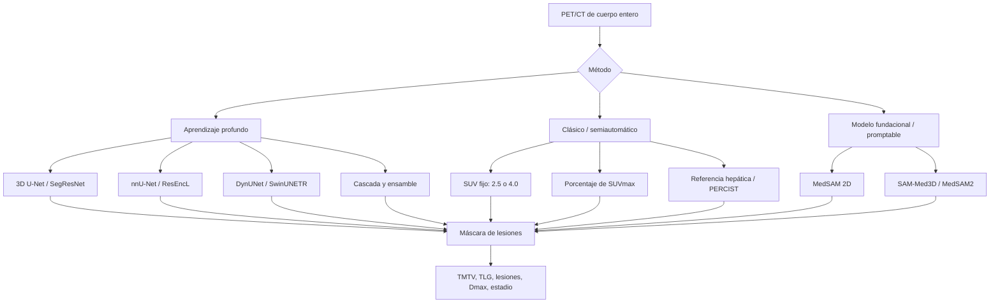
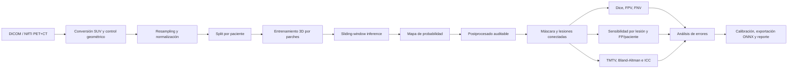

# Estado del arte: detección y evaluación de lesiones de linfoma mediante FDG-PET/CT e inteligencia artificial

## Resumen ejecutivo

El FDG-PET/CT es el estándar funcional para estadificación y respuesta en los linfomas ávidos por FDG. Lugano y Deauville consolidaron la lectura visual, pero la cuantificación de carga tumoral —en especial el volumen metabólico tumoral total (TMTV)— aporta información pronóstica aún no incorporada uniformemente a la práctica. La segmentación manual o semiautomática varía entre métodos, software y lectores. Los umbrales absolutos, sobre todo SUV ≥ 4, ofrecen mayor reproducibilidad que los porcentajes del SUVmax, aunque no hay equivalencia entre protocolos. En aprendizaje profundo, 3D U-Net, nnU-Net y SegResNet dominan la evidencia; transformers y modelos fundacionales no han demostrado ventaja consistente en PET/CT de linfoma. autoPET mostró que los ensambles 3D y el preentrenamiento multimodal mejoran el rendimiento, pero autoPET III confirmó que la generalización a combinaciones inéditas de trazador y centro sigue abierta. La validación externa, las lesiones pequeñas, los falsos positivos fisiológicos y la calibración de incertidumbre importan más que diferencias marginales de Dice. Para un proyecto académico con cómputo limitado, la opción defendible es un baseline 3D compacto, evaluación por vóxel, lesión y paciente, y una mejora validada por ablación.

## 1. Introducción clínica

### 1.1 Linfomas y papel del FDG-PET/CT

El linfoma de Hodgkin clásico, el linfoma difuso de células B grandes (DLBCL) y el linfoma folicular representan escenarios biológicos y terapéuticos distintos, pero los tres suelen ser ávidos por FDG. El FDG-PET/CT integra metabolismo y anatomía: detecta enfermedad ganglionar y extranodal, orienta la biopsia, establece extensión basal, mide respuesta temprana y documenta respuesta al final del tratamiento [1–3]. En DLBCL y Hodgkin, esta sensibilidad funcional supera a la TC aislada para lesiones viables; en folicular, el PET/CT también identifica transformación sospechosa y carga tumoral, aunque la historia natural indolente modifica el significado pronóstico [1,2,5].

Lugano reemplazó la dependencia de la suma de diámetros por una evaluación adaptada a la avidez por FDG. En enfermedad ávida, la respuesta se interpreta con la escala Deauville de cinco puntos, comparando la captación tumoral con mediastino e hígado [1,2]. Una puntuación 1–3 suele equivaler a respuesta metabólica completa en el contexto terapéutico estándar; 4–5 exige interpretar intensidad, cambio respecto al basal y aparición de lesiones. El ensayo RATHL demostró que el PET interino puede guiar de-escalada en Hodgkin avanzado, pero esa evidencia no convierte cualquier clasificador automático de Deauville en una herramienta para cambiar tratamiento sin validación prospectiva [4].

El criterio de interpretación también cambia el valor pronóstico. Un metaanálisis actualizado del PET interino en DLBCL (66 estudios, 9.335 pacientes) encontró una tasa de respuesta metabólica completa muy variable entre estudios (38–94%; I² = 92,45%). Un PET interino positivo se asoció con peor supervivencia libre de progresión (HR agrupado 3,05; 63 estudios). Usar solo Deauville 5 como umbral elevó el HR a 5,72, con heterogeneidad moderada (I² = 40,7%), mientras que ΔSUVmax mostró un efecto más débil (HR 1,83) [53]. Cualquier automatización de Deauville hereda, por tanto, la elección de umbral.

### 1.2 Biomarcadores cuantitativos

Los índices más utilizados son:

- **SUVmax:** máximo voxelar dentro de una lesión. Es simple, pero representa un único vóxel y depende de reconstrucción, tiempo de captación y ruido [3].
- **SUVmean:** promedio dentro de una segmentación; resulta más estable, aunque depende directamente del contorno.
- **MTV/TMTV:** volumen metabólicamente activo por lesión y suma por paciente. TMTV aproxima carga tumoral global [5–8].
- **TLG:** producto de MTV y SUVmean, por lesión o total. Combina volumen e intensidad, pero hereda los errores de ambos.
- **Dmax:** distancia máxima entre dos lesiones; mide diseminación espacial y aporta información distinta de TMTV [9].
- **Heterogeneidad/radiómica:** texturas, formas y descriptores de distribución. Pueden capturar fenotipos no resumidos por SUV o volumen, pero son sensibles al tamaño, discretización, reconstrucción y segmentación.

La evidencia multicéntrica respalda el valor pronóstico de TMTV en folicular, Hodgkin y DLBCL [5,6,10–12]. El corte de 510 cm³ en folicular fue útil en un análisis agrupado, pero no debe tratarse como constante biológica: los puntos de corte cambian con población, método y software [5,7,11]. El International Metabolic Prognostic Index propuso tratar MTV como variable continua junto con edad y estadio, una solución metodológicamente más estable que dicotomizarlo [12]. Dmax puede mejorar la estratificación porque separa carga y dispersión [9]. La interpretación crítica es que TMTV es un biomarcador pronóstico robusto a nivel de asociación, pero su utilidad clínica depende de reproducibilidad, calibración y decisiones terapéuticas demostradas.

Los metaanálisis recientes en linfoma folicular apoyan esa asociación. Uno, publicado como resumen de congreso (11 estudios, 2.631 pacientes de alta carga tumoral), estimó para TMTV elevado un HR de 1,91 para supervivencia libre de progresión, de 1,78 para supervivencia global y un OR de 3,72 para progresión en 24 meses. El corte más validado fue >510 cm³ y TMTV fue independiente de FLIPI y PRIMA-PI en análisis multivariados [50]. Otro (16 estudios, 2.313 pacientes) encontró que MTV y TLG predicen ambas supervivencias, con TLG como el predictor más fuerte (HR 9,71 para supervivencia global), mientras SUVmax solo se asoció con supervivencia libre de progresión (HR 2,14) [51].

La calidad de esta evidencia es limitada. Una revisión sistemática de 41 estudios en Hodgkin y DLBCL encontró capacidad predictiva del MTV en 17/19 estudios de DLBCL y en 6/8 de Hodgkin, pero todos los estudios tenían riesgo de sesgo moderado o alto; la mayoría eran retrospectivos, con poca potencia y sin validación externa [52].

En radiómica, una revisión sistemática en Hodgkin (9 estudios retrospectivos) encontró que en 7 los modelos radiómicos o multimodales superaron a los clínicos o volumétricos (AUC 0,86–0,92), y que integrar varias lesiones mejoró la predicción frente a analizar una sola lesión diana [58]. Un metaanálisis de radiómica diagnóstica en linfoma (20 estudios) obtuvo un AUC resumen de 0,90, con heterogeneidad alta (I² = 83,7%) [59]. Ambos trabajos señalan la falta de validación externa multicéntrica como el límite principal.

## 2. Datasets y benchmarks

### 2.1 Recursos públicos y acceso real

| Recurso                      |                                                                Tamaño verificado | Población / trazador                                                           | Anotación                                | Acceso/licencia                         | Limitación principal                                                                                                       |
| ---------------------------- | --------------------------------------------------------------------------------: | ------------------------------------------------------------------------------- | ----------------------------------------- | --------------------------------------- | --------------------------------------------------------------------------------------------------------------------------- |
| FDG-PET-CT-Lesions / autoPET | 1.014 estudios; 501 casos con melanoma, linfoma o NSCLC y 513 controles negativos | FDG, cuerpo entero                                                              | Lesiones manuales                         | TCIA; condiciones de la colección      | Un centro y un escáner para la cohorte original; no identifica por sí solo un split público exclusivo de linfoma [13,42] |
| autoPET III                  |                        1.014 FDG + 597 PSMA para desarrollo; test de 200 estudios | FDG y PSMA, dos centros de desarrollo y combinaciones centro-trazador inéditas | Lesiones manuales; test oculto            | Grand Challenge / publicación del reto | No es específico de linfoma; el test final no se descarga [22]                                                             |
| Benchmark internacional TMTV |                           60 estudios basales: 20 folicular, 20 Hodgkin, 20 DLBCL | FDG                                                                             | 12 expertos; 3–4 lectores por caso; SUV4 | Dataset público usado para validación | Enriquecido en casos difíciles; pequeño para entrenar [15,18]                                                             |
| HECKTOR 2022                 |  524 casos para tarea de segmentación y 356 de prueba, según la página oficial | Cáncer de cabeza y cuello, FDG                                                 | GTV primario y ganglionar                 | Grand Challenge; registro               | No es linfoma; útil para transferencia y evaluación multicéntrica, no para conclusiones clínicas de linfoma [24,47,48]  |
| CALGB 50303 PET substudy     |                                                           158 pacientes elegibles | DLBCL, FDG                                                                      | Revisión central en ensayo clínico      | Publicación abierta                    | No se verificó un repositorio público descargable de imágenes; no debe anunciarse como dataset abierto [14]              |
| RECOMIA                      |                                                     Plataforma, no cohorte única | Varias modalidades y trazadores                                                 | Depende del proyecto                      | Acceso investigador autenticado         | Es infraestructura de análisis, no dataset descargable [41]                                                                |

El descriptor de FDG-PET-CT-Lesions documenta 1.014 estudios de cuerpo entero y aclara una confusión recurrente: 900 pacientes no equivalen a 900 estudios; algunos pacientes tienen más de un examen [13]. La colección es adecuada para aprender captación tumoral general, pero mezcla indicaciones y su distribución no representa de forma pura Hodgkin, DLBCL o folicular. Un split debe realizarse por paciente, no por estudio, para impedir fuga longitudinal.

autoPET I/II establecieron una prueba oculta de segmentación oncológica; el análisis publicado de autoPET mostró predominio de 3D U-Net y beneficio de ensambles [21]. autoPET III elevó la dificultad al combinar FDG y PSMA y evaluar pares trazador-centro no vistos. Participaron 17 equipos con 27 algoritmos; el mejor método alcanzó Dice medio 0,66, FNV 3,18 mL y FPV 2,78 mL en las cuatro condiciones del test [22]. Estas cifras no deben compararse con Dice de tests preliminares o con cohortes de linfoma, porque cambian trazadores, instituciones y prevalencia.

El benchmark internacional de 60 casos es especialmente valioso para cuantificación: el TMTV final cubrió 8–2.288 cm³ y 52/60 casos mostraron acuerdo entre lectores dentro de ±10% o ±10 cm³ [15]. La captación esplénica difusa y la exclusión de captación fisiológica explicaron buena parte de los desacuerdos. Su validación con una red 3D U-Net de MONAI, entrenada con 1.500 estudios de linfoma, mostró concordancia dentro de ±10% o ±10 cm³ en 50/60 casos (83%), cifra cercana al acuerdo entre lectores del propio benchmark (52/60, 87%). En 4 de los 10 casos restantes, el resultado coincidió con al menos uno de los expertos [15,18]. Ese resultado no sustituye una evaluación amplia de sensibilidad por lesión.

### 2.2 Taxonomía de métodos

## 3. Métodos de segmentación y detección

Las revisiones recientes organizan la IA aplicada al PET/CT de linfoma en tres dominios: segmentación de lesiones, diagnóstico diferencial y estratificación pronóstica. También describen el paso de flujos radiómicos que dependen de una delineación manual o semiautomática a sistemas de aprendizaje profundo de extremo a extremo [54]. La segmentación es el dominio habilitante, porque de ella dependen TMTV, Dmax y cualquier rasgo posterior.

### 3.1 Umbrales y métodos semiautomáticos

Los umbrales absolutos SUV 2,5 y SUV 4,0 son transparentes y rápidos. En cohortes antiguas de DLBCL, SUV 2,5 mostró buen rendimiento pronóstico y concordancia entre observadores [7,8]. Sin embargo, el consenso reciente favorece SUV ≥ 4,0 con volumen lesional mínimo de 3 cm³ para TMTV basal, porque reduce inclusión fisiológica y facilita reproducibilidad multicéntrica [15–17]. En 1.960 pacientes de ensayos LYSA, SUV4 y 41% SUVmax tuvieron asociación pronóstica comparable, aunque la correlación de los volúmenes fue mayor en DLBCL que en folicular o Hodgkin [17].

El umbral relativo de 41% SUVmax se adapta a la intensidad de cada lesión, pero puede infrasegmentar lesiones heterogéneas y cambia al variar la definición de SUVmax. También requiere más interacción y presenta mayor variación entre implementaciones [7,15,16]. La normalización respecto al hígado conecta con PERCIST y Deauville; automatizar hígado y pool mediastínico puede estandarizar referencias, pero una referencia estable no elimina la necesidad de revisar captación fisiológica [40].

Ningún umbral resuelve por sí solo cerebro, corazón, riñones, sistema urinario, músculo activado, inflamación o grasa parda. Los sistemas semiautomáticos eficaces combinan preselección sensible y corrección humana. Esto explica por qué la concordancia de TMTV puede ser alta aunque las máscaras voxel a voxel no coincidan exactamente.

### 3.2 Redes convolucionales 3D

3D U-Net sigue siendo el patrón práctico porque conserva contexto volumétrico y permite inferencia por parches. MONAI ofrece implementaciones reproducibles de UNet, SegResNet, DynUNet y SwinUNETR [27]. nnU-Net automatiza resampling, tamaño de parche, normalización y configuración de entrenamiento; su fortaleza no es una capa novedosa sino adaptar el pipeline al dataset [25]. Los presets ResEnc amplían la capacidad del encoder, y ResEncL se ha propuesto como nuevo baseline fuerte, pero su costo excede una GPU gratuita típica [26].

El estudio comparativo específico de linfoma evaluó ResUNet, SegResNet, DynUNet y SwinUNETR sobre 611 casos de varias cohortes: 466 internos (302 de entrenamiento, 76 de validación y 88 de test) y 145 externos. El test externo corresponde al subconjunto de linfoma de autoPET (145 estudios de 144 pacientes). En ese test externo, SegResNet obtuvo Dice mediana 0,68 y FPV mediana 21,46 mL, evidencia directa de las dificultades fuera de distribución [19,46]. En ese trabajo, SwinUNETR no superó de forma consistente a la CNN. Esta comparación contradice la suposición de que un transformer mejora automáticamente la segmentación 3D. UNETR y SwinUNETR siguen siendo arquitecturas relevantes, pero su evidencia fundacional procede sobre todo de MRI, no de PET/CT de linfoma [28,29].

TMTV-Net utilizó una cascada: ensamble multirresolución de 3D U-Net seguido de una red refinadora que recibe PET, CT y probabilidades. Se desarrolló con 900 estudios y se probó externamente en 518 estudios de linfoma de varios centros [20]. Su escala y evaluación clínica son fortalezas; su complejidad y licencia restringida a investigación dificultan reproducibilidad y despliegue.

En DLBCL, una 3D U-Net entrenada con 297 pacientes de un centro y validada en 117 de otro alcanzó un Dice medio de 0,78 ± 0,25 en la cohorte externa. El TMTV predicho (276,6 frente a 301,9 cm³ de media en referencia y predicción) mostró buena concordancia y fue un factor pronóstico independiente: con un corte de ≥ 201,2 cm³, el HR fue 3,10 para supervivencia libre de progresión y 6,60 para supervivencia global [57]. Es uno de los pocos trabajos que valida a la vez segmentación y valor pronóstico del TMTV automático en un centro externo.

### 3.3 Fusión PET/CT, cascadas y aumentación

La **fusión temprana** concatena PET y CT como canales. Es simple y domina autoPET, pero obliga a la red a tolerar resoluciones, ruido y posibles desalineaciones distintas [21,22]. La **fusión tardía** usa encoders independientes y combina características o decisiones; separa estadísticas de modalidad, pero incrementa parámetros y exige más datos. Una estrategia intermedia usa PET para sensibilidad metabólica, CT para anatomía y una rama o prior anatómico para suprimir órganos fisiológicos.

Las cascadas clasifican cortes o regiones, detectan candidatos y después segmentan. Reducen el espacio de búsqueda y falsos positivos, pero un fallo en la primera etapa es irrecuperable. Para cuerpo entero, una alternativa más segura es un primer modelo sensible y un segundo refinador que preserve candidatos con incertidumbre.

El ganador model-centric de autoPET III combinó nnU-Net ResEncL, aumentación explícita de desalineación PET/CT, preentrenamiento multimodal en CT/MR/PET y supervisión auxiliar de órganos [23]. Reportó Dice 68,40 en su evaluación, frente a 57,61 del nnU-Net por defecto y 65,31 de ResEncL sin las mejoras. Estas cifras pertenecen al estudio de la solución y no son equivalentes al 0,66 agregado del test oficial [22,23]. El mecanismo es clínicamente plausible: desplazar una modalidad durante entrenamiento reduce dependencia de registro perfecto, mientras el aprendizaje anatómico ayuda a distinguir tumor de captación fisiológica.

### 3.4 Modelos fundacionales y priors anatómicos

TotalSegmentator segmenta 104 estructuras en CT y puede generar máscaras de cerebro, corazón, riñones, vejiga y otros órganos para postprocesado o como canales auxiliares [30]. Su evidencia es CT, no captación tumoral en PET. Por tanto, debe describirse como prior anatómico, no como segmentador de linfoma.

MedSAM fue entrenado con más de 1,5 millones de pares imagen-máscara y múltiples modalidades [31]. SAM-Med3D y MedSAM2 extienden la idea al volumen y seguimiento [32,33]. Estos modelos son útiles para anotación asistida y adaptación con pocos casos, pero la evidencia disponible no demuestra que superen a nnU-Net o SegResNet en segmentación automática de lesiones FDG de cuerpo entero. Los prompts, memoria y coste de inferencia también complican un pipeline completamente automático. La oportunidad realista es usarlos para acelerar corrección humana o preanotación, no sustituir de inmediato el baseline especializado.

### 3.5 Pipeline típico de desarrollo y evaluación

La separación entre postprocesado y métricas permite auditar qué candidatos fueron eliminados. El split debe preceder cualquier ajuste estadístico o selección de hiperparámetros para evitar fuga.

## 4. Evaluación y métricas

### 4.1 Tres niveles de evaluación

Una evaluación clínica no puede reducirse a Dice.

1. **Vóxel/volumen:** Dice, FPV y FNV. Dice mide solapamiento relativo; FPV y FNV expresan mililitros añadidos u omitidos y son más interpretables cuando la carga varía varios órdenes de magnitud.
2. **Lesión:** sensibilidad por lesión, falsos positivos por paciente y distribución por tamaño. Una lesión puede considerarse detectada por intersección no vacía, IoU mínimo o fracción de solapamiento; el criterio debe declararse. El estudio de 611 casos mostró que conclusiones clínicas cambian según el criterio de matching [19].
3. **Paciente/biomarcador:** error absoluto y relativo de TMTV, sesgo y límites de acuerdo de Bland–Altman, ICC con intervalo de confianza y concordancia de estratos de riesgo.

Para dos máscaras binarias, Dice = 2TP/(2TP+FP+FN). No debe promediarse sin informar casos negativos: un paciente sin lesión plantea la convención 1 si predicción y referencia están vacías, pero ese valor puede inflar el promedio. Conviene reportar negativos por separado con tasa de falsos positivos.

FPV y FNV deben calcularse con el volumen voxelar físico, no con conteo bruto de vóxeles. La sensibilidad por lesión requiere matching uno-a-uno o reglas explícitas para lesiones fusionadas y fragmentadas. Se recomienda presentar resultados por tamaño (<1 mL, 1–10 mL, >10 mL, por ejemplo), localización y subtipo.

### 4.2 Fiabilidad frente a lectores

El benchmark de 60 casos define una referencia de consenso y un margen clínico de ±10% o ±10 cm³ para TMTV [15]. Bland–Altman revela sesgo dependiente de carga que un ICC alto puede ocultar. El ICC mide ordenamiento y acuerdo global, pero puede parecer excelente cuando el rango de TMTV es enorme. Deben presentarse ambos.

Comparar un modelo con una sola máscara no estima incertidumbre del ground truth. Cuando existan varias lecturas, el modelo debe contrastarse con cada lector y con consenso. La pregunta correcta es si el error del sistema cae dentro de la variación interlector, no si reproduce exactamente una máscara arbitraria [15,18].

## 5. Generalización, robustez y fiabilidad

### 5.1 Cambio de dominio

Las fuentes principales de shift son escáner y reconstrucción, dosis, tiempo postinyección, resolución, centro, población, trazador y prevalencia. El Dice mediano 0,68 y la FPV mediana 21,46 mL del test externo de 145 casos en el estudio de linfoma muestran que la evaluación fuera de distribución sigue siendo exigente [19]. autoPET III muestra un problema más fuerte: la combinación nueva de centro y trazador produce sobreestimación sistemática incluso cuando cada componente se vio por separado [22].

La validación externa debe estar separada por institución y paciente. Una partición aleatoria de estudios del mismo centro mide interpolación, no generalización clínica. La normalización de SUV y CT, resampling homogéneo y aumentación de desalineación son mitigaciones razonables, pero no sustituyen un test externo.

### 5.2 Falsos positivos y lesiones pequeñas

Cerebro, miocardio, hígado, bazo, riñón, uréteres y vejiga concentran actividad fisiológica; inflamación, granulomas y brown fat añaden captación benigna. Los priors anatómicos permiten enmascarar o penalizar parte de esos órganos, pero una exclusión rígida puede borrar enfermedad extranodal real. Debe preferirse un prior suave o una regla revisable.

Las lesiones pequeñas sufren efecto de volumen parcial y tienen pocos vóxeles, de modo que una traslación mínima reduce Dice de forma desproporcionada. Por eso se requieren sensibilidad por lesión y curvas según tamaño. Un modelo puede acertar TMTV total dominado por masas grandes y omitir lesiones pequeñas clínicamente relevantes.

Se han propuesto respuestas arquitectónicas a este problema. Izadi et al. combinaron U-Net y DenseNet con pérdida Tversky para reducir la pérdida en lesiones muy pequeñas en Hodgkin; con 141 casos de entrenamiento y dos tests de 20 casos, obtuvieron un Dice medio de 0,759 [55]. PSR-Nets introducen una regularización de *prior shift* para segmentar linfoma de cuerpo entero con fuerte desbalance de clases y salidas calibradas [56]. Ambos se evaluaron en cohortes pequeñas y de un solo origen, por lo que su beneficio en lesiones pequeñas fuera de distribución sigue sin demostrarse.

### 5.3 Incertidumbre, calibración y explicabilidad

La literatura revisada informa poco sobre calibración. Ensembles y test-time augmentation generan dispersión, pero esa dispersión no es automáticamente una probabilidad calibrada. Deben evaluarse Expected Calibration Error o Brier score a nivel de candidato, curvas precisión–recobrado y cobertura–riesgo para abstención. Una salida útil marca casos que requieren revisión, especialmente captación esplénica difusa, región urinaria o discrepancia PET/CT.

La explicabilidad en segmentación debe ser espacial y causal: mapa de probabilidad, candidatos eliminados por postprocesado y contribución de PET frente a CT. Los mapas de atención no prueban razonamiento clínico. La auditoría por subgrupos debe incluir subtipo, centro, sexo, edad, carga tumoral y tamaño de lesión cuando los metadatos estén disponibles.

## 6. Eficiencia y despliegue

El baseline oficial de autoPET documenta nnU-Net 3D full-resolution con 16 GB de VRAM, 1.000 épocas y validación cruzada de cinco folds; el baseline MONAI usa parches 128×128×32, batch 12 y 800 épocas [47]. Esos presupuestos exceden lo razonable para GPU gratuita en Colab/Kaggle si se repiten completos. Un proyecto académico debe reducir parches, canales, folds y épocas con early stopping, y reservar un único test.

ONNX permite separar entrenamiento PyTorch e inferencia [45]. ONNX Runtime ofrece cuantización dinámica y estática INT8 con formatos QDQ/QOperator, pero la cuantización no es sin pérdida y debe revalidarse, especialmente en lesiones pequeñas [43]. Ryzen AI recomienda opset 17, modelos INT8 o BF16 y partición automática entre NPU y CPU en Windows [44]. No se encontró evidencia primaria de un 3D U-Net PET/CT completo ejecutándose de extremo a extremo en esa NPU. Operadores 3D no soportados pueden caer a CPU, por lo que exportar correctamente no demuestra aceleración.

Una ruta prudente es: exportar con forma de parche fija, comparar PyTorch CPU con ONNX Runtime CPU, cuantizar solo después de verificar Dice/TMTV y probar el Vitis AI Execution Provider como experimento opcional. Deben medirse latencia por volumen, memoria pico y fracción de operadores asignados a NPU.

## 7. Tabla comparativa resumida

> Las métricas de filas distintas no son comparables directamente: cambian cohortes, trazadores, splits, prevalencia y definición de lesión.

| Estudio                | Tarea / entrada                    | Arquitectura                                            | Validación                       | Resultado contextualizado                                   | Limitación                                                 |
| ---------------------- | ---------------------------------- | ------------------------------------------------------- | --------------------------------- | ----------------------------------------------------------- | ----------------------------------------------------------- |
| Ahamed et al. [19]     | Lesiones de linfoma, PET+CT        | ResUNet, SegResNet, DynUNet, SwinUNETR                    | 611 casos; test externo 145       | SegResNet: Dice mediana 0,68 y FPV 21,46 mL en test externo | Cohortes retrospectivas; rendimiento fuera de distribución |
| TMTV-Net [20]          | TMTV de linfoma, PET+CT            | Cascada y ensamble 3D U-Net                             | 518 externos multicéntricos      | Evalúa Dice, TMTV y revisión médica                      | Pipeline pesado; licencia de investigación                 |
| autoPET [21]           | Lesiones oncológicas FDG, PET+CT  | Predominio 3D U-Net; ensamble                           | Test privado 150, dos centros     | Ensamble superior a modelos individuales                    | Mezcla tumores; test oculto                                 |
| autoPET III [22]       | FDG+PSMA, PET+CT                   | 27 algoritmos, mayoría nnU-Net                         | 200 casos, 4 condiciones          | Top: Dice 0,66, FNV 3,18 mL, FPV 2,78 mL                    | Generalización composicional no resuelta                   |
| LesionTracer/DKFZ [23] | autoPET III                        | nnU-Net ResEncL + pretraining + órganos + misalignment | Challenge                         | Dice 68,40 en evaluación del paper                         | No comparar directamente con ranking final                  |
| Benchmark IA TMTV [18] | Linfoma, PET+CT                    | 3D U-Net                                                | Benchmark 60, múltiples lectores | Dentro de ±10% o ±10 cm³ en 50/60                        | Dataset pequeño y difícil                                 |
| AutoLugano [34]        | Segmentación + regiones + estadio | 3D nnU-Net + TotalSegmentator + reglas                  | Externa 67                        | Accuracy 85,07% limitado/avanzado                           | Preprint; externa pequeña                                  |
| Hasanabadi et al. [35] | Estadio, PET radiomics             | ML con rasgos nodales/extranodales                      | Multicéntrica, n=241             | AUC externa 0,87                                            | Retrospectivo                                               |
| Li et al. [36]         | Estadio, MIP PET/CT                | DL multivista 2D                                        | 5-fold, n=227                     | AUC 0,942                                                   | Sin test institucional independiente                        |
| Jiang et al. [37]      | Pronóstico DLBCL, PET             | VGG19 + DenseNet121                                     | 3 centros, n=684                  | C-index PFS externo 0,760                                   | Asociación retrospectiva, no impacto clínico              |

## 8. Brechas y oportunidades

1. **Generalización específica de linfoma.** autoPET es grande, pero no sustituye una cohorte externa con subtipo, centro y protocolo distintos [13,19,22].
2. **Detección y cuantificación conjunta.** Optimizar Dice global puede ocultar falsos negativos pequeños y error de TMTV. La evaluación debe ser multiescala y clínica [15,18,19].
3. **Captación fisiológica.** Supervisión anatómica y priors CT son prometedores, pero deben permitir enfermedad extranodal y cuantificar errores por órgano [23,30].
4. **Desalineación PET/CT.** Es frecuente y pocas publicaciones la modelan explícitamente. La aumentación de desplazamiento es barata y verificable mediante ablación [23].
5. **Subtipos infrarrepresentados.** DLBCL domina la literatura de radiómica y pronóstico; Hodgkin y folicular tienen menos validación externa automatizada [38,39,49].
6. **Incertidumbre y abstención.** Falta calibración prospectiva y definición de cuándo el sistema debe remitir un caso a revisión.
7. **Despliegue medido, no supuesto.** ONNX y NPU son compatibles a nivel de herramientas, pero faltan benchmarks PET/CT 3D en Ryzen AI [43–45].
8. **De segmentación a decisión.** AutoLugano demuestra viabilidad técnica, pero todavía se necesita validación prospectiva de estadio, respuesta y cambio de manejo [34–36].

Estas brechas justifican un proyecto enfocado en segmentación basal de linfoma con evaluación por lesión y TMTV, no en predicción de respuesta clínica sin etiquetas longitudinales.

## 9. Conclusiones

El tema plantea dos preguntas: si la tecnología existe y si es mejorable. La tecnología existe: FDG-PET/CT es el estándar de estadificación y respuesta, TMTV tiene valor pronóstico respaldado por metaanálisis, y la segmentación automática alcanza en benchmarks una concordancia cercana a la de los expertos [1,18,50–52]. También es mejorable, y la literatura señala dónde: lesiones pequeñas, estandarización de métodos y cortes, validación externa y prospectiva, y criterios de interpretación del PET interino [19,22,52,53].

La evidencia establecida por múltiples estudios es que FDG-PET/CT estructura el estadiaje y la respuesta en linfoma, y que TMTV añade valor pronóstico [1–6,10–12]. También está establecido que la segmentación y el software alteran los valores absolutos; SUV4 ofrece una ruta de estandarización, no una verdad única [7,15–17].

Un solo estudio multicéntrico o challenge no demuestra generalización universal. El rendimiento del estudio de 611 casos en su conjunto externo y el reto composicional de autoPET III indican que el principal problema es robustez, no escoger entre variantes cercanas de arquitectura [19,22]. Para una entrega académica con cómputo limitado, la contribución defendible es un pipeline reproducible con split por paciente, baseline 3D compacto, una o dos mejoras motivadas, y evaluación de Dice, FPV/FNV, sensibilidad por lesión, FP/paciente y acuerdo de TMTV. Predicción de Deauville o respuesta debe quedar como extensión condicionada a datos adecuados.

## Referencias

1. Cheson BD, Fisher RI, Barrington SF, et al. Recommendations for Initial Evaluation, Staging, and Response Assessment of Hodgkin and Non-Hodgkin Lymphoma: The Lugano Classification. *Journal of Clinical Oncology*. 2014;32(27):3059–3068. DOI: [10.1200/JCO.2013.54.8800](https://doi.org/10.1200/JCO.2013.54.8800). PMID: 25113753.
2. Barrington SF, Mikhaeel NG, Kostakoglu L, et al. Role of Imaging in the Staging and Response Assessment of Lymphoma: Consensus of the ICML Imaging Working Group. *Journal of Clinical Oncology*. 2014;32(27):3048–3058. DOI: [10.1200/JCO.2013.53.5229](https://doi.org/10.1200/JCO.2013.53.5229). PMID: 25113771.
3. Boellaard R, Delgado-Bolton R, Oyen WJG, et al. FDG PET/CT: EANM Procedure Guidelines for Tumour Imaging: Version 2.0. *European Journal of Nuclear Medicine and Molecular Imaging*. 2015;42(2):328–354. DOI: [10.1007/s00259-014-2961-x](https://doi.org/10.1007/s00259-014-2961-x). PMID: 25452219.
4. Johnson P, Federico M, Kirkwood A, et al. Adapted Treatment Guided by Interim PET-CT Scan in Advanced Hodgkin's Lymphoma. *New England Journal of Medicine*. 2016;374:2419–2429. DOI: [10.1056/NEJMoa1510093](https://doi.org/10.1056/NEJMoa1510093). PMID: 27332902.
5. Meignan M, Cottereau AS, Versari A, et al. Baseline Metabolic Tumor Volume Predicts Outcome in High-Tumor-Burden Follicular Lymphoma: A Pooled Analysis of Three Multicenter Studies. *Journal of Clinical Oncology*. 2016;34(30):3618–3626. DOI: [10.1200/JCO.2016.66.9440](https://doi.org/10.1200/JCO.2016.66.9440). PMID: 27551111.
6. Mikhaeel NG, Smith D, Dunn JT, et al. Combination of Baseline Metabolic Tumour Volume and Early Response on PET/CT Improves Progression-Free Survival Prediction in DLBCL. *European Journal of Nuclear Medicine and Molecular Imaging*. 2016;43(7):1209–1219. DOI: [10.1007/s00259-016-3315-7](https://doi.org/10.1007/s00259-016-3315-7). PMID: 26902371.
7. Ilyas H, Mikhaeel NG, Dunn JT, et al. Defining the Optimal Method for Measuring Baseline Metabolic Tumour Volume in Diffuse Large B Cell Lymphoma. *European Journal of Nuclear Medicine and Molecular Imaging*. 2018;45(7):1142–1154. DOI: [10.1007/s00259-018-3953-z](https://doi.org/10.1007/s00259-018-3953-z). PMID: 29460024.
8. Guzman Ortiz S, Mucientes Rasilla J, et al. Evaluación del valor pronóstico de los diferentes métodos de cálculo del volumen metabólico tumoral con 18F-FDG PET/TC, en pacientes con linfoma B difuso de células grandes. *Revista Espanola de Medicina Nuclear e Imagen Molecular*. 2020;39(6):340–346. DOI: [10.1016/j.remn.2020.06.007](https://doi.org/10.1016/j.remn.2020.06.007). PMID: 32646783.
9. Cottereau AS, Nioche C, Dirand AS, et al. 18F-FDG PET Dissemination Features in Diffuse Large B-Cell Lymphoma Are Predictive of Outcome. *Journal of Nuclear Medicine*. 2020;61(1):40–45. Disponible en: [https://pmc.ncbi.nlm.nih.gov/articles/PMC6935691/](https://pmc.ncbi.nlm.nih.gov/articles/PMC6935691/).
10. Durmo R, et al. Prognostic Value of Baseline Metabolic Tumour Volume in Patients with Advanced-Stage Hodgkin Lymphoma. *Scientific Reports*. 2021;11:23195. PMID: 34853386.
11. Meignan M, Cottereau AS, Specht L, Mikhaeel NG. Total Tumor Burden in Lymphoma – An Evolving Strong Prognostic Parameter. *British Journal of Radiology*. 2021;94(1127):20210448. DOI: [10.1259/bjr.20210448](https://doi.org/10.1259/bjr.20210448). PMID: 34379496.
12. Mikhaeel NG, et al. Proposed New Dynamic Prognostic Index for Diffuse Large B-Cell Lymphoma: International Metabolic Prognostic Index. *Journal of Clinical Oncology*. 2022;40(21):2352–2360. DOI: [10.1200/JCO.21.02063](https://doi.org/10.1200/JCO.21.02063). PMID: 35709465.
13. Gatidis S, Kustner T, et al. A Whole-Body FDG-PET/CT Dataset with Manually Annotated Tumor Lesions. *Scientific Data*. 2022;9:601. DOI: [10.1038/s41597-022-01718-3](https://doi.org/10.1038/s41597-022-01718-3).
14. Schoder H, et al. Prognostic Value of Interim FDG-PET in Diffuse Large Cell Lymphoma: Results from the CALGB 50303 Clinical Trial. *Blood*. 2020. Disponible en: [https://pmc.ncbi.nlm.nih.gov/articles/PMC7316220/](https://pmc.ncbi.nlm.nih.gov/articles/PMC7316220/).
15. Boellaard R, Buvat I, Nioche C, et al. International Benchmark for Total Metabolic Tumor Volume Measurement in Baseline 18F-FDG PET/CT of Lymphoma Patients: A Milestone Toward Clinical Implementation. *Journal of Nuclear Medicine*. 2024;65(9):1343–1348. DOI: [10.2967/jnumed.124.267789](https://doi.org/10.2967/jnumed.124.267789). PMID: 39089812.
16. Barrington SF, Cottereau AS, Zijlstra JM. Is 18F-FDG Metabolic Tumor Volume in Lymphoma Really Happening?. *Journal of Nuclear Medicine*. 2024;65(4):510–511. DOI: [10.2967/jnumed.123.267022](https://doi.org/10.2967/jnumed.123.267022). PMID: 38388515.
17. Malmon S, Elsensohn MH, Thieblemont C, et al. Prognostic Impact of Metabolic Tumor Volume Using the SUV4.0 Segmentation Threshold in 1,960 Lymphoma Patients from Prospective LYSA Trials. *European Journal of Nuclear Medicine and Molecular Imaging*. 2025;52(9):3180–3189. DOI: [10.1007/s00259-025-07176-4](https://doi.org/10.1007/s00259-025-07176-4). PMID: 40108044.
18. Sadik M, Larsson M, Enqvist O, Edenbrandt L, Tragardh E. Validation of an AI Method for Automated Lymphoma Metabolic Tumor Volume Segmentation Using a Public Benchmark PET/CT Dataset. *Journal of Nuclear Medicine*. 2026;67(6):1001–1005. DOI: [10.2967/jnumed.125.271605](https://doi.org/10.2967/jnumed.125.271605). PMID: 41786479.
19. Ahamed S, Xu Y, Kurkowska S, et al. Comprehensive Framework for Evaluation of Deep Neural Networks in Detection and Quantification of Lymphoma from PET/CT Images: Clinical Insights, Pitfalls, and Observer Agreement Analyses. *Physica Medica*. 2026;148:105832. DOI: [10.1016/j.ejmp.2026.105832](https://doi.org/10.1016/j.ejmp.2026.105832). Preprint: [arXiv:2311.09614](https://arxiv.org/abs/2311.09614). PMID: 42284693.
20. Yousefirizi F, Klyuzhin IS, O JH, et al. TMTV-Net: Fully Automated Total Metabolic Tumor Volume Segmentation in Lymphoma PET/CT Images: A Multi-Center Generalizability Analysis. *European Journal of Nuclear Medicine and Molecular Imaging*. 2024;51:1937–1954. DOI: [10.1007/s00259-024-06616-x](https://doi.org/10.1007/s00259-024-06616-x).
21. Gatidis S, et al. The autoPET Challenge: Towards Fully Automated Lesion Segmentation in Oncologic PET/CT Imaging. *Nature Machine Intelligence*. 2024;6:1396–1405. DOI: [10.1038/s42256-024-00912-9](https://doi.org/10.1038/s42256-024-00912-9).
22. Dexl J, Jeblick K, Mittermeier A, et al. The autoPET3 Challenge: Automated Lesion Segmentation in Whole-Body PET/CT – Multitracer Multicenter Generalization. *arXiv preprint* arXiv:2605.05775. 2026. [arXiv:2605.05775](https://arxiv.org/abs/2605.05775).
23. Rokuss MR, et al. A Hitchhiker's Guide to Multitracer, Multicenter Lesion Segmentation in PET/CT Imaging. *arXiv preprint* arXiv:2409.09478. 2024. [arXiv:2409.09478](https://arxiv.org/abs/2409.09478).
24. Andrearczyk V, Oreiller V, Abobakr M, et al. Overview of the HECKTOR Challenge at MICCAI 2022: Automatic Head and Neck Tumor Segmentation and Outcome Prediction in PET/CT. *Head and Neck Tumor Segmentation and Outcome Prediction* (LNCS). 2023;13626:1–30. DOI: [10.1007/978-3-031-27420-6_1](https://doi.org/10.1007/978-3-031-27420-6_1).
25. Isensee F, Jaeger PF, Kohl SAA, Petersen J, Maier-Hein KH. nnU-Net: A Self-Configuring Method for Deep Learning-Based Biomedical Image Segmentation. *Nature Methods*. 2021;18:203–211. DOI: [10.1038/s41592-020-01008-z](https://doi.org/10.1038/s41592-020-01008-z).
26. Isensee F, et al. nnU-Net Revisited: A Call for Rigorous Validation in 3D Medical Image Segmentation. *arXiv preprint* arXiv:2404.09556. 2024. [arXiv:2404.09556](https://arxiv.org/abs/2404.09556).
27. Cardoso MJ, Li W, Brown R, et al. MONAI: An Open-Source Framework for Deep Learning in Healthcare. *arXiv preprint* arXiv:2211.02701. 2022. [arXiv:2211.02701](https://arxiv.org/abs/2211.02701).
28. Hatamizadeh A, Tang Y, Nath V, et al. UNETR: Transformers for 3D Medical Image Segmentation. *Proceedings of WACV*. 2022:574–584. Disponible en: [https://openaccess.thecvf.com/content/WACV2022/html/Hatamizadeh_UNETR_Transformers_for_3D_Medical_Image_Segmentation_WACV_2022_paper.html](https://openaccess.thecvf.com/content/WACV2022/html/Hatamizadeh_UNETR_Transformers_for_3D_Medical_Image_Segmentation_WACV_2022_paper.html).
29. Hatamizadeh A, Nath V, Tang Y, et al. Swin UNETR: Swin Transformers for Semantic Segmentation of Brain Tumors in MRI Images. *arXiv preprint* arXiv:2201.01266. 2022. [arXiv:2201.01266](https://arxiv.org/abs/2201.01266).
30. Wasserthal J, Breit HC, Meyer MT, et al. TotalSegmentator: Robust Segmentation of 104 Anatomic Structures in CT Images. *Radiology: Artificial Intelligence*. 2023;5(5):e230024. DOI: [10.1148/ryai.230024](https://doi.org/10.1148/ryai.230024).
31. Ma J, He Y, Li F, et al. Segment Anything in Medical Images. *Nature Communications*. 2024;15:654. DOI: [10.1038/s41467-024-44824-z](https://doi.org/10.1038/s41467-024-44824-z).
32. Wang H, et al. SAM-Med3D: Towards General-purpose Segmentation Models for Volumetric Medical Images. *arXiv preprint* arXiv:2310.15161. 2023. [arXiv:2310.15161](https://arxiv.org/abs/2310.15161).
33. Zhuo L, et al. MedSAM2: Segment Anything in 3D Medical Images and Videos. *arXiv preprint* arXiv:2504.03600. 2025. [arXiv:2504.03600](https://arxiv.org/abs/2504.03600).
34. Pan B, Zhang Z, Meng H, et al. AutoLugano: A Deep Learning Framework for Fully Automated Lymphoma Segmentation and Lugano Staging on FDG-PET/CT. *arXiv preprint* arXiv:2512.07206. 2025. DOI: [10.48550/arXiv.2512.07206](https://doi.org/10.48550/arXiv.2512.07206).
35. Hasanabadi S, Aghamiri SMR, Abin AA, et al. Automatic Lugano Staging for Risk Stratification in Lymphoma: A Multicenter PET Radiomics and Machine Learning Study with Survival Analysis. *Nuclear Medicine Communications*. 2025;46(12):1200–1211. DOI: [10.1097/MNM.0000000000002046](https://doi.org/10.1097/MNM.0000000000002046). PMID: 40900042.
36. Li D, Li R, Ma Y, et al. Multi-View Deep Learning for Automated Lymphoma Staging from 18F-FDG PET/CT: Physician-Level Accuracy with High-Throughput Workflow. *EJNMMI Research*. 2026;16:48. DOI: [10.1186/s13550-025-01357-w](https://doi.org/10.1186/s13550-025-01357-w). PMID: 41686381.
37. Jiang C, et al. Robust Deep Learning-Based PET Prognostic Imaging Biomarker for Diffuse Large B-Cell Lymphoma Patients: A Multicenter Study. *European Journal of Nuclear Medicine and Molecular Imaging*. 2023;50(13):3949–3960. DOI: [10.1007/s00259-023-06405-y](https://doi.org/10.1007/s00259-023-06405-y). PMID: 37606859.
38. Driessen J, et al. A Prognostic Model Using 18F-FDG PET Radiomics Predicts Progression-Free Survival in Relapsed or Refractory Classical Hodgkin Lymphoma. *Blood Advances*. 2023;7(21):6732–6743. DOI: [10.1182/bloodadvances.2023010404](https://doi.org/10.1182/bloodadvances.2023010404). PMID: 37722357.
39. Mehrabi Nejad A, et al. Performance of AI Methods in PET-Based Imaging for Outcome Prediction in Lymphoma: A Systematic Review and Meta-Analysis. *European Journal of Radiology*. 2025;190:112204. DOI: [10.1016/j.ejrad.2025.112204](https://doi.org/10.1016/j.ejrad.2025.112204). PMID: 40466216.
40. Grossiord E, et al. Automated Quantification of Reference Levels in Liver and Mediastinal Blood Pool for the Deauville Therapy Response Classification Using FDG-PET/CT in Hodgkin and Non-Hodgkin Lymphomas. *European Journal of Nuclear Medicine and Molecular Imaging*. 2019. Disponible en: [https://pubmed.ncbi.nlm.nih.gov/30284376/](https://pubmed.ncbi.nlm.nih.gov/30284376/). PMID: 30284376.
41. Tragardh E, et al. RECOMIA: A Cloud-Based Platform for Artificial Intelligence Research in Nuclear Medicine and Radiology. *EJNMMI Physics*. 2020;7:51. DOI: [10.1186/s40658-020-00316-9](https://doi.org/10.1186/s40658-020-00316-9).
42. The Cancer Imaging Archive. *FDG-PET-CT-Lesions Collection*. 2022. Disponible en: [https://www.cancerimagingarchive.net/collection/fdg-pet-ct-lesions/](https://www.cancerimagingarchive.net/collection/fdg-pet-ct-lesions/). Consultado el 2026-10-29.
43. ONNX Runtime. *Quantize ONNX Models*. 2026. Disponible en: [https://onnxruntime.ai/docs/performance/model-optimizations/quantization.html](https://onnxruntime.ai/docs/performance/model-optimizations/quantization.html). Consultado el 2026-10-29.
44. Advanced Micro Devices. *Ryzen AI: Model Compilation and Deployment*. 2026. Disponible en: [https://ryzenai.docs.amd.com/en/latest/modelrun.html](https://ryzenai.docs.amd.com/en/latest/modelrun.html). Consultado el 2026-10-29.
45. PyTorch. *torch.onnx Documentation*. 2026. Disponible en: [https://docs.pytorch.org/docs/stable/onnx.html](https://docs.pytorch.org/docs/stable/onnx.html). Consultado el 2026-10-29.
46. Microsoft AI for Good Lab. *lymphoma-segmentation-dnn*. 2026. Disponible en: [https://github.com/microsoft/lymphoma-segmentation-dnn](https://github.com/microsoft/lymphoma-segmentation-dnn). Consultado el 2026-10-29. MIT License.
47. autoPET Challenge Organizers. *autoPET Baselines and Data Utilities*. 2024. Disponible en: [https://github.com/lab-midas/autoPET](https://github.com/lab-midas/autoPET). Consultado el 2026-10-29. MIT License.
48. HECKTOR Challenge Organizers. *HECKTOR 2022 Data*. 2022. Disponible en: [https://hecktor.grand-challenge.org/Data/](https://hecktor.grand-challenge.org/Data/). Consultado el 2026-10-29.
49. Kanavos T, et al. A Systematic Review of the Applications of Deep Learning for the Interpretation of Positron Emission Tomography Images of Patients with Lymphoma. *Cancers*. 2025;17(1):69. DOI: [10.3390/cancers17010069](https://doi.org/10.3390/cancers17010069). PMID: 39796698.
50. Bodrova E, Patel K, Bollu B, Chovatiya JA, et al. Total Metabolic Tumor Volume as a Prognostic Biomarker in High-Burden Follicular Lymphoma: A Systematic Review and Meta-Analysis. *Blood*. 2025;146(Supplement 1):7127. DOI: [10.1182/blood-2025-7127](https://doi.org/10.1182/blood-2025-7127). Resumen de congreso (ASH 2025).
51. Wang X, Chen Y, Huang Y. Prognostic Value of 18F-FDG PET/CT Parameters at Baseline and End of Treatment in Follicular Lymphoma: A Systematic Review and Meta-analysis. *Academic Radiology*. 2025;32(11):6840–6856. DOI: [10.1016/j.acra.2025.08.003](https://doi.org/10.1016/j.acra.2025.08.003). PMID: 40850863.
52. Frood R, Burton CH, Tsoumpas C, Frangi AF, Gleeson F, Patel C, Scarsbrook A. Baseline PET/CT Imaging Parameters for Prediction of Treatment Outcome in Hodgkin and Diffuse Large B Cell Lymphoma: A Systematic Review. *European Journal of Nuclear Medicine and Molecular Imaging*. 2021;48(10):3198–3220. DOI: [10.1007/s00259-021-05233-2](https://doi.org/10.1007/s00259-021-05233-2). PMID: 33604689.
53. Albano D, Chauvie S, Rizzo A, Bertagna F, et al. The Prognostic Role of Interim [18F]FDG PET/CT in Diffuse Large B-Cell Lymphoma: An Updated Systematic Review and Meta-analysis. *Clinical Lymphoma, Myeloma and Leukemia*. 2026;26(8):491–510.e1. DOI: [10.1016/j.clml.2026.06.008](https://doi.org/10.1016/j.clml.2026.06.008). PMID: 42409674.
54. Liu Q, Sun R, Chen X, Liu Y, et al. Artificial Intelligence-Based PET/CT Analysis in Lymphoma: Segmentation, Differential Diagnosis, and Prognostic Stratification. *Holistic Integrative Oncology*. 2026;5(1). DOI: [10.1007/s44178-026-00294-5](https://doi.org/10.1007/s44178-026-00294-5).
55. Izadi MA, Alemohammad N, Geramifar P, et al. Automatic Detection and Segmentation of Lesions in 18F-FDG PET/CT Imaging of Patients with Hodgkin Lymphoma Using 3D Dense U-Net. *Nuclear Medicine Communications*. 2024;45(11):963–973. DOI: [10.1097/MNM.0000000000001892](https://doi.org/10.1097/MNM.0000000000001892). PMID: 39224914.
56. Wang M, Jiang H, Shi T, et al. PSR-Nets: Deep Neural Networks with Prior Shift Regularization for PET/CT Based Automatic, Accurate, and Calibrated Whole-Body Lymphoma Segmentation. *Computers in Biology and Medicine*. 2022;151(Pt A):106215. DOI: [10.1016/j.compbiomed.2022.106215](https://doi.org/10.1016/j.compbiomed.2022.106215).
57. Jiang C, Chen K, Teng Y, et al. Deep Learning-Based Tumour Segmentation and Total Metabolic Tumour Volume Prediction in the Prognosis of Diffuse Large B-Cell Lymphoma Patients in 3D FDG-PET Images. *European Radiology*. 2022;32(7):4801–4812. DOI: [10.1007/s00330-022-08573-1](https://doi.org/10.1007/s00330-022-08573-1). PMID: 35166895.
58. Pradère C, Mucientes Rasilla J, Navarro Matilla B, et al. Prognostic Value of Radiomics Based on 18F-FDG PET/CT in Hodgkin Lymphoma: A Systematic Review. *Revista Española de Medicina Nuclear e Imagen Molecular (English Edition)*. 2026:500323. DOI: [10.1016/j.remnie.2026.500323](https://doi.org/10.1016/j.remnie.2026.500323). PMID: 42128173. Online ahead of print.
59. Liu C, Zhao J, Zhang H, et al. Diagnostic Value of 18F-FDG PET/CT Radiomics in Lymphoma: A Systematic Review and Meta-Analysis. *Technology in Cancer Research & Treatment*. 2025;24:15330338251342860. DOI: [10.1177/15330338251342860](https://doi.org/10.1177/15330338251342860).

## Informe de verificación y descartes

**Verificado:** se abrieron fuentes primarias o páginas oficiales para Lugano/Deauville, autoPET, autoPET III, el benchmark TMTV de 60 casos, TMTV-Net, el estudio de 611 casos, AutoLugano, estadiaje multivista, ONNX Runtime y Ryzen AI. Se comprobó que el benchmark contiene 20 casos de cada subtipo y que cada caso fue segmentado por 3–4 de 12 expertos; que autoPET III recibió 27 algoritmos de 17 equipos; y que CALGB 50303 describe una cohorte de ensayo, no un repositorio público de imágenes.

**No verificado o no reportado:** no se encontró un dataset público con pares longitudinales pre/post y etiquetas clínicas de respuesta Deauville/Lugano listo para entrenar un predictor. Tampoco se encontró un benchmark publicado de 3D U-Net PET/CT en la NPU Ryzen AI. Hardware y tiempo no reportados se dejan como “no reportado” en la tabla CSV.

**Incorporado de una segunda revisión del equipo (verificado):** se añadieron [50]–[59] tras localizar cada fuente por DOI o PMID y cotejar las cifras con su resumen. [50] es un resumen de congreso, no un artículo revisado por pares. De [54] solo se usa la descripción cualitativa: el reparto por número de estudios que circulaba no aparece en el resumen. De [59] se usan las cifras del resumen (20 estudios, AUC 0,90) y no la comparación DL frente a ML clásico, que no figura en él.

**Descartado de esa revisión:** Feres et al. (*Clin Transl Imaging*, 2022, TMTV en Hodgkin), porque no se pudo acceder al resumen para verificar sus cifras; y los trabajos sobre escáneres LAFOV, adquisición ultratardía y 18F-FLT, por quedar fuera del alcance de un proyecto de aprendizaje automático.

**Descartado:** blogs, noticias, copias de ResearchGate cuando existía fuente primaria, métricas de tests preliminares presentadas como resultados finales, y referencias cuyo título/identificador no pudo confirmarse. TotalSegmentator, MedSAM y HECKTOR se conservan solo como evidencia de prior, transferencia o benchmark vecino; no se presentan como validación directa de linfoma.
