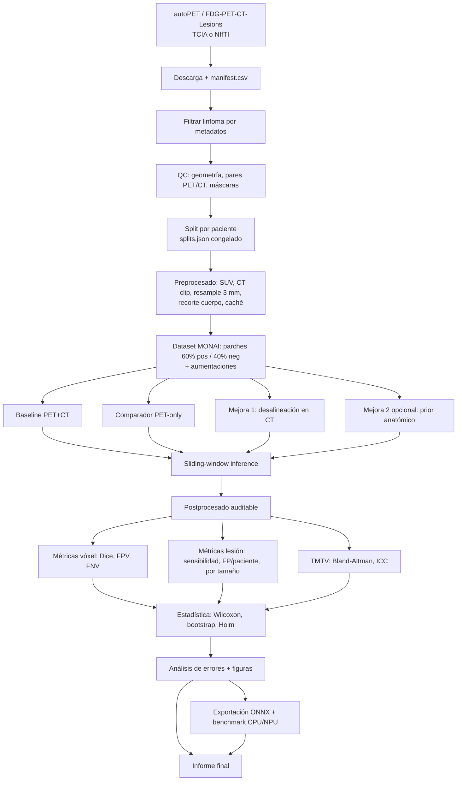

# Roadmap, pipeline y tareas del proyecto

## **Tema** Optimización de la detección y evaluación de lesiones en linfomas mediante PET/CT

---

## 1. Objetivo y alcance

**Objetivo:** construir y evaluar un baseline 3D de segmentación binaria de lesiones de linfoma en FDG-PET/CT basal, con una mejora principal de robustez y una mejora opcional, y evaluarlo en tres niveles (vóxel, lesión y paciente/TMTV).

**Hipótesis a contrastar** (de `gaps_y_oportunidades.md`):

- **H1.** SegResNet 3D con PET+CT supera a PET-only en Dice y FNV sin aumentar excesivamente el FPV.
- **H2.** La aumentación de desalineación reduce la degradación bajo desplazamientos PET/CT sintéticos sin perjudicar el test limpio.
- **H3 (opcional).** Un prior anatómico suave reduce FPV en órganos fisiológicos sin perder lesiones extranodales.
- **H4.** Mejorar Dice no garantiza mejor acuerdo de TMTV; se analizan por separado.

**Fuera de alcance:** predicción de respuesta o pronóstico (no hay dataset público con pares longitudinales y etiquetas clínicas verificado). Se menciona solo como trabajo futuro.

**Reglas que no se negocian** (son las que protegen la validez del trabajo):

1. Split **por paciente**, congelado y versionado antes de entrenar nada.
2. El **test no se toca** hasta congelar arquitectura, umbral y postprocesado. Se evalúa una sola vez.
3. Ninguna cifra del informe se escribe a mano: sale de archivos en `results/`.
4. No se afirma nada sobre NPU sin haberlo medido.
5. No se comparan Dice de datasets distintos como si fueran equivalentes.

---

## 2. Equipo y forma de trabajo

El trabajo se agrupa por lo que se construye(componentes):

| Componente | Qué se construye | Fases |
|---|---|---|
| **Base** | Repo, entorno, contratos, tests y CI | 0, 2 |
| **Datos** | Descarga, manifiesto, QC, split, preprocesado, caché | 1 |
| **Modelo** | Loader, aumentaciones, arquitectura, mejoras | 2, 4 |
| **Entrenamiento** | Bucle de entrenamiento y corridas: los seis entrenan | 2-4 |
| **Evaluación** | Métricas, postprocesado, estadística, análisis de errores | 2-5 |
| **Despliegue** | ONNX, benchmark CPU/NPU, demo | 6 |
| **Informe** | Redacción, figuras, reproducibilidad, entrega | 7 |

Reglas del reparto:

1. Cada fase tiene tareas obligatorias de para cada integrante
2. Cada integrante entrena al menos un modelo: P3 el baseline PET+CT, P4 el PET-only, P2 la variante con desalineación; P1, P5 y P6 las semillas adicionales (baseline, PET-only y desalineación); además todos corren el smoke test (T24).
3. Cada PR lo revisa el siguiente en el anillo P1→P2→P3→P4→P5→P6→P1, para que todos conozcan todo el flujo.
4. Matrices completas (por componente y por fase), carga por persona y plan semanal: ver `issues_tareas.md`.

---

## 3. Pipeline técnico



### Etapas, entradas y salidas

| # | Etapa | Entrada | Salida | Dónde vive |
|---|---|---|---|---|
| 1 | Adquisición | TCIA / NIfTI de autoPET | `data/raw/` + `data/manifest.csv` | `scripts/download_data.py` |
| 2 | Selección y QC | manifiesto + metadatos | `data/manifest_lymphoma.csv`, `results/qc_report.md` | `src/lymphoma/data/qc.py` |
| 3 | Split | manifiesto de linfoma | `data/splits/splits.json` (congelado) | `src/lymphoma/data/split.py` |
| 4 | Preprocesado | NIfTI crudos | `data/processed/<id>/{pet,ct,mask}.nii.gz` | `src/lymphoma/data/preprocess.py` |
| 5 | Entrenamiento | procesados + `splits.json` + config | `checkpoints/<exp>/best.pt`, `results/<exp>/train_log.csv` | `src/lymphoma/training/train.py` |
| 6 | Inferencia | checkpoint + estudio | `results/<exp>/pred/<id>.nii.gz` | `src/lymphoma/evaluation/infer.py` |
| 7 | Evaluación | predicciones + referencia | `results/<exp>/metrics_*.json/csv` | `src/lymphoma/evaluation/metrics.py` |
| 8 | Estadística | métricas por paciente de varios experimentos | `results/stats/*.csv`, figuras | `src/lymphoma/evaluation/stats.py` |
| 9 | Despliegue | checkpoint final | `deploy/model.onnx`, `results/deploy/benchmark.csv` | `src/lymphoma/deploy/` |
| 10 | Informe | todo lo anterior | `docs/informe_final.md` (o PDF) | `docs/` |

### Contratos de interfaz entre integrantes

Para trabajar **en paralelo** sin bloquearse

- **`manifest.csv`**: `patient_id, study_id, diagnosis, date, pet_path, ct_path, mask_path, suv_available, n_lesions, tmtv_ml, include (bool), exclude_reason`.
- **`splits.json`**: `{"seed": 42, "mode": "holdout|5fold", "train": [patient_id...], "val": [...], "test": [...], "folds": {...}}`. Los IDs son de **paciente**.
- **Volúmenes procesados**: NIfTI en el mismo espacio (3 mm isotrópico), PET en SUV original guardado aparte (`suv.nii.gz`) para métricas.
- **Predicciones**: NIfTI binario con el mismo geometría que la máscara de referencia, nombrado `<study_id>.nii.gz`.
- **Métricas por paciente**: CSV con una fila por `study_id` y columnas `dice, fpv_ml, fnv_ml, n_lesions_ref, n_lesions_pred, tp_lesions, fp_lesions, tmtv_ref_ml, tmtv_pred_ml`.
- **Configs**: un YAML por experimento en `configs/` (`baseline_petct.yaml`, `baseline_petonly.yaml`, `misalign.yaml`, `anatomic_prior.yaml`).

---

## 4. Estructura del repositorio

```
Lymphoma-Machine-Learning/
├── README.md
├── ROADMAP.md                  # este documento
├── docs/                       # estado del arte, plan, informe
├── configs/                    # un YAML por experimento
├── data/                       # NO se sube a git
│   ├── raw/  processed/  splits/
├── src/lymphoma/
│   ├── data/                   # manifest, qc, split, preprocess, dataset
│   ├── models/                 # segresnet, wrappers
│   ├── training/               # train, losses, sampling
│   ├── evaluation/             # infer, postprocess, metrics, stats
│   └── deploy/                 # export_onnx, bench
├── scripts/                    # utilidades de línea de comandos
├── notebooks/                  # runners para Kaggle/Colab (finos, sin lógica)
├── results/                    # métricas, figuras, logs (CSV/JSON pequeños sí van a git)
├── tests/                      # pytest de transforms y métricas
├── requirements.txt            # o environment.yml
└── .gitignore                  # data/, checkpoints/, *.nii.gz, *.pt
```

**Regla de oro:** la lógica va en `src/`, los notebooks solo la invocan. Así el código se prueba en la laptop y se ejecuta igual en Kaggle/Colab.

---

## 5. Roadmap por fases

Las duraciones son **estimaciones de planificación**. Las fases 1 y 2 se hacen **en paralelo**: unos preparan los volúmenes mientras otros escriben código y lo prueban con 5 casos mínimo.

| Fase | Nombre | Duración est. | Hito de salida |
|---|---|---|---|
| 0 | Arranque y convenciones | 1 día | Repo, entorno, tablero y contratos listos |
| 1 | Datos | 2–3 días | Split congelado + 10 casos preprocesados verificados visualmente |
| 2 | Código base | 2–3 días (paralelo a 1) | Loader, modelo, loss y métricas con tests pasando |
| 3 | Baselines | 2–3 días | Baseline PET+CT y PET-only entrenados, checkpoint congelado |
| 4 | Mejoras | 2–3 días | Variante con desalineación entrenada (y prior si hay tiempo) |
| 5 | Evaluación y estadística | 2 días | Test ejecutado una vez, tablas y figuras |
| 6 | Despliegue | 1–2 días (paralelo a 5) | ONNX validado y benchmark CPU |
| 7 | Informe y entrega | 2–3 días (arranca en fase 3) | Informe revisado, repo reproducible |

**Ruta crítica:** 0 → 1 → 3 → 4 → 5 → 7. El entrenamiento en GPU gratuita es el cuello de botella: cada corrida pesa 6–10 h según el plan, y la cuota semanal de GPU en Kaggle/Colab es limitada (verifiquen la de cada cuenta).

```mermaid
gantt
    dateFormat  YYYY-MM-DD
```mermaid
gantt
    dateFormat  YYYY-MM-DD
    axisFormat  %d/%m
    title Roadmap (cierre interno 20/12; colchón 21-31/12)
    Fase 0 Arranque :f0, 2026-11-02, 2026-11-08
    Fase 1 Datos :f1, 2026-11-09, 2026-11-22
    Fase 2 Código base :f2, 2026-11-09, 2026-11-22
    Fase 3 Baselines :f3, 2026-11-23, 2026-12-01
    Fase 4 Mejoras :f4, 2026-12-02, 2026-12-08
    Fase 5 Evaluación :f5, 2026-12-09, 2026-12-13
    Fase 6 Despliegue :f6, 2026-12-09, 2026-12-15
    Fase 7 Informe y entrega :f7, 2026-11-09, 2026-12-20
```

---

## 6. Configuración sugerida de GitHub

**Milestones:** `Fase 0 - Arranque`, `Fase 1 - Datos`, `Fase 2 - Código base`, `Fase 3 - Baselines`, `Fase 4 - Mejoras`, `Fase 5 - Evaluación`, `Fase 6 - Despliegue`, `Fase 7 - Informe y entrega`.

**Etiquetas:** `datos`, `modelado`, `evaluacion`, `estadistica`, `despliegue`, `redaccion`, `entrenamiento`, `calidad`, `decision`, `infra`, `setup`, `diseno`, `entrega`, `opcional`, `bloqueado`, `todos`, `fase-0`, `fase-1`, `fase-2`, `fase-3`, `fase-4`, `fase-5`, `fase-6`, `fase-7`, `P1`, `P2`, `P3`, `P4`, `P5`, `P6`. `P1`-`P6` marcan responsable; no son roles.

**Tablero (GitHub Projects):** columnas `Backlog` → `Listo` → `En curso` → `En revisión` → `Hecho`. Campos útiles: Responsable, Fase, Estimación (horas) y Bloqueado por.

Creación automática (dentro del clon del repo, con `gh auth login` hecho):

```bash
python create_issues.py --dry-run
python create_issues.py --users "P1=u1,P2=u2,P3=u3,P4=u4,P5=u5,P6=u6"
```

**Definition of Done para cualquier issue:** código en `main` vía PR revisado por el revisor asignado, tests pasando, salida documentada (archivo en `results/` o sección en `docs/`) y issue cerrado con enlace al PR.

---

## 7. Riesgos y Plan B

| Riesgo | Señal temprana | Plan B |
|---|---|---|
| Datos demasiado grandes | La descarga o el preprocesado no terminan | Trabajar con 40–80 pacientes estratificados y declararlo estudio piloto |
| Pocos casos identificables como linfoma | Metadatos insuficientes | Preentrenar con cohorte oncológica general y evaluar solo en los casos de linfoma |
| OOM en T4/P100 | El parche 96³ no cabe | 80³, `init_filters=12`, gradient accumulation |
| Entrenamiento >12 h | Época demasiado lenta | 150 épocas, menos muestras por época, early stopping, una semilla |
| Sesión de Kaggle/Colab se corta | Pérdida de progreso | Checkpoint cada N épocas y reanudación (T18) |
| Cuota de GPU agotada | Cuenta sin horas | Repartir corridas entre las cuentas de los seis |
| TotalSegmentator no cabe en tiempo | Precómputo >4 h | Omitir mejora 2; quedarse con la desalineación |
| FP fisiológicos altos | FPV dominado por vejiga/cerebro | Postprocesado auditable y análisis por órgano, sin borrar rígidamente |
| ONNX falla por operadores 3D | Error de exportación o discrepancia numérica | Exportar solo el núcleo con forma fija; sliding-window en PyTorch |
| NPU hace fallback completo | 0% de subgrafos en NPU | Reportar CPU ONNX; no afirmar aceleración |
| Test muy pequeño | IC muy anchos | Resultados exploratorios con bootstrap, sin sobreinterpretar p |
| Compañero bloqueado | Issue sin avance 48 h | Reasignar o dividir; revisión diaria del tablero por quien coordine esa semana |

---

## 8. Ritmo de trabajo sugerido

- **Daily corto (10 min)** por chat: qué hice, qué haré, qué me bloquea.
- **Revisión de PRs en menos de 24 h** para no frenar la ruta crítica.
- **Hitos de integración:** al final de las fases 1, 3 y 5 se hace una reunión corta para verificar que las salidas cumplen los contratos.
- **Cuando llegue el test (T36):** ejecuta quien coordine esa semana, con los seis presentes y la congelación firmada en el issue. Sin reintentos por resultados que no gustan.

---

## 9. Criterios de finalización del proyecto

- [ ] Split por paciente congelado y versionado
- [ ] Baseline PET+CT y comparador PET-only completados
- [ ] Mejora de desalineación evaluada en test limpio y perturbado
- [ ] Dice, FPV, FNV, sensibilidad por lesión, FP/paciente y TMTV reportados
- [ ] Bland-Altman e ICC incluidos
- [ ] Errores por tamaño y captación fisiológica revisados
- [ ] Exportación ONNX validada o fallo documentado
- [ ] Ninguna afirmación sobre NPU sin medición real
- [ ] Informe con todas sus cifras trazables a `results/`
- [ ] Repositorio reproducible por alguien que no escribió el código
