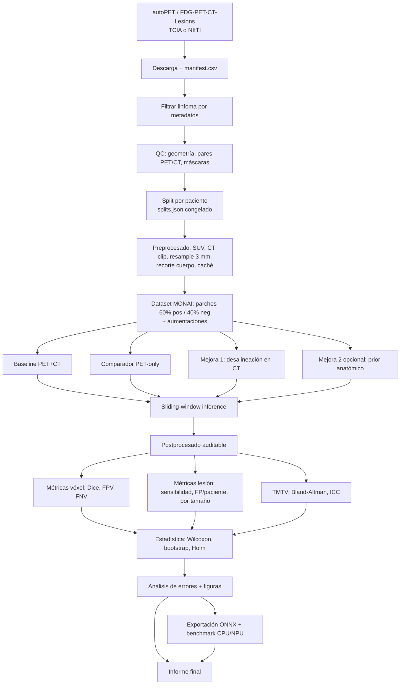

# Roadmap, pipeline y tareas del proyecto

## **Tema** Optimización de la detección y evaluación de lesiones en linfomas mediante PET/CT

---

## 1. Objetivo y alcance

**Objetivo:** construir y evaluar un baseline 3D de segmentación binaria de lesiones de linfoma en FDG-PET/CT basal, con una mejora principal de robustez y una mejora opcional, y evaluarlo en tres niveles (vóxel, lesión y paciente/TMTV).

**Hipótesis a contrastar** (de `gaps_y_oportunidades.md`):

- **H1.** SegResNet 3D con PET+CT supera a PET-only en Dice y FNV sin aumentar excesivamente el FPV.
- **H2.** La aumentación de desalineación reduce la degradación bajo desplazamientos PET/CT sintéticos sin perjudicar el test limpio.
- **H3 (opcional).** Un prior anatómico suave reduce FPV en órganos fisiológicos sin perder lesiones extranodales.
- **H4.** Mejorar Dice no garantiza mejor acuerdo de TMTV; se analizan por separado.

**Fuera de alcance:** predicción de respuesta o pronóstico (no hay dataset público con pares longitudinales y etiquetas clínicas verificado). Se menciona solo como trabajo futuro.

**Reglas que no se negocian** (son las que protegen la validez del trabajo):

1. Split **por paciente**, congelado y versionado antes de entrenar nada.
2. El **test no se toca** hasta congelar arquitectura, umbral y postprocesado. Se evalúa una sola vez.
3. Ninguna cifra del informe se escribe a mano: sale de archivos en `results/`.
4. No se afirma nada sobre NPU sin haberlo medido.
5. No se comparan Dice de datasets distintos como si fueran equivalentes.

---

## 2. Equipo y forma de trabajo

El trabajo se agrupa por lo que se construye(componentes):

| Componente | Qué se construye | Fases |
|---|---|---|
| **Base** | Repo, entorno, contratos, tests y CI | 0, 2 |
| **Datos** | Descarga, manifiesto, QC, split, preprocesado, caché | 1 |
| **Modelo** | Loader, aumentaciones, arquitectura, mejoras | 2, 4 |
| **Entrenamiento** | Bucle de entrenamiento y corridas: los seis entrenan | 2-4 |
| **Evaluación** | Métricas, postprocesado, estadística, análisis de errores | 2-5 |
| **Despliegue** | ONNX, benchmark CPU/NPU, demo | 6 |
| **Informe** | Redacción, figuras, reproducibilidad, entrega | 7 |

Reglas del reparto:

1. Cada fase tiene tareas obligatorias de para cada integrante
2. Cada integrante entrena al menos un modelo: P3 el baseline PET+CT, P4 el PET-only, P2 la variante con desalineación; P1, P5 y P6 las semillas adicionales (baseline, PET-only y desalineación); además todos corren el smoke test (T24).
3. Cada PR lo revisa el siguiente en el anillo P1→P2→P3→P4→P5→P6→P1, para que todos conozcan todo el flujo.
4. Matrices completas (por componente y por fase), carga por persona y plan semanal: ver `issues_tareas.md`.

---

## 3. Pipeline técnico



### Etapas, entradas y salidas

| # | Etapa | Entrada | Salida | Dónde vive |
|---|---|---|---|---|
| 1 | Adquisición | TCIA / NIfTI de autoPET | `data/raw/` + `data/manifest.csv` | `scripts/download_data.py` |
| 2 | Selección y QC | manifiesto + metadatos | `data/manifest_lymphoma.csv`, `results/qc_report.md` | `src/lymphoma/data/qc.py` |
| 3 | Split | manifiesto de linfoma | `data/splits/splits.json` (congelado) | `src/lymphoma/data/split.py` |
| 4 | Preprocesado | NIfTI crudos | `data/processed/<id>/{pet,ct,mask}.nii.gz` | `src/lymphoma/data/preprocess.py` |
| 5 | Entrenamiento | procesados + `splits.json` + config | `checkpoints/<exp>/best.pt`, `results/<exp>/train_log.csv` | `src/lymphoma/training/train.py` |
| 6 | Inferencia | checkpoint + estudio | `results/<exp>/pred/<id>.nii.gz` | `src/lymphoma/evaluation/infer.py` |
| 7 | Evaluación | predicciones + referencia | `results/<exp>/metrics_*.json/csv` | `src/lymphoma/evaluation/metrics.py` |
| 8 | Estadística | métricas por paciente de varios experimentos | `results/stats/*.csv`, figuras | `src/lymphoma/evaluation/stats.py` |
| 9 | Despliegue | checkpoint final | `deploy/model.onnx`, `results/deploy/benchmark.csv` | `src/lymphoma/deploy/` |
| 10 | Informe | todo lo anterior | `docs/informe_final.md` (o PDF) | `docs/` |

### Contratos de interfaz entre integrantes

Para trabajar **en paralelo** sin bloquearse

- **`manifest.csv`**: `patient_id, study_id, diagnosis, date, pet_path, ct_path, mask_path, suv_available, n_lesions, tmtv_ml, include (bool), exclude_reason`.
- **`splits.json`**: `{"seed": 42, "mode": "holdout|5fold", "train": [patient_id...], "val": [...], "test": [...], "folds": {...}}`. Los IDs son de **paciente**.
- **Volúmenes procesados**: NIfTI en el mismo espacio (3 mm isotrópico), PET en SUV original guardado aparte (`suv.nii.gz`) para métricas.
- **Predicciones**: NIfTI binario con el mismo geometría que la máscara de referencia, nombrado `<study_id>.nii.gz`.
- **Métricas por paciente**: CSV con una fila por `study_id` y columnas `dice, fpv_ml, fnv_ml, n_lesions_ref, n_lesions_pred, tp_lesions, fp_lesions, tmtv_ref_ml, tmtv_pred_ml`.
- **Configs**: un YAML por experimento en `configs/` (`baseline_petct.yaml`, `baseline_petonly.yaml`, `misalign.yaml`, `anatomic_prior.yaml`).

---

## 4. Estructura del repositorio

```
Lymphoma-Machine-Learning/
├── README.md
├── ROADMAP.md                  # este documento
├── docs/                       # estado del arte, plan, informe
├── configs/                    # un YAML por experimento
├── data/                       # NO se sube a git
│   ├── raw/  processed/  splits/
├── src/lymphoma/
│   ├── data/                   # manifest, qc, split, preprocess, dataset
│   ├── models/                 # segresnet, wrappers
│   ├── training/               # train, losses, sampling
│   ├── evaluation/             # infer, postprocess, metrics, stats
│   └── deploy/                 # export_onnx, bench
├── scripts/                    # utilidades de línea de comandos
├── notebooks/                  # runners para Kaggle/Colab (finos, sin lógica)
├── results/                    # métricas, figuras, logs (CSV/JSON pequeños sí van a git)
├── tests/                      # pytest de transforms y métricas
├── requirements.txt            # o environment.yml
└── .gitignore                  # data/, checkpoints/, *.nii.gz, *.pt
```

**Regla de oro:** la lógica va en `src/`, los notebooks solo la invocan. Así el código se prueba en la laptop y se ejecuta igual en Kaggle/Colab.

---

## 5. Roadmap por fases

Las duraciones son **estimaciones de planificación**. Las fases 1 y 2 se hacen **en paralelo**: unos preparan los volúmenes mientras otros escriben código y lo prueban con 5 casos mínimo.

| Fase | Nombre | Duración est. | Hito de salida |
|---|---|---|---|
| 0 | Arranque y convenciones | 1 día | Repo, entorno, tablero y contratos listos |
| 1 | Datos | 2–3 días | Split congelado + 10 casos preprocesados verificados visualmente |
| 2 | Código base | 2–3 días (paralelo a 1) | Loader, modelo, loss y métricas con tests pasando |
| 3 | Baselines | 2–3 días | Baseline PET+CT y PET-only entrenados, checkpoint congelado |
| 4 | Mejoras | 2–3 días | Variante con desalineación entrenada (y prior si hay tiempo) |
| 5 | Evaluación y estadística | 2 días | Test ejecutado una vez, tablas y figuras |
| 6 | Despliegue | 1–2 días (paralelo a 5) | ONNX validado y benchmark CPU |
| 7 | Informe y entrega | 2–3 días (arranca en fase 3) | Informe revisado, repo reproducible |

**Ruta crítica:** 0 → 1 → 3 → 4 → 5 → 7. El entrenamiento en GPU gratuita es el cuello de botella: cada corrida pesa 6–10 h según el plan, y la cuota semanal de GPU en Kaggle/Colab es limitada (verifiquen la de cada cuenta).

```mermaid
gantt
    dateFormat  YYYY-MM-DD
```mermaid
gantt
    dateFormat  YYYY-MM-DD
    axisFormat  %d/%m
    title Roadmap (cierre interno 20/12; colchón 21-31/12)
    Fase 0 Arranque :f0, 2026-11-02, 2026-11-08
    Fase 1 Datos :f1, 2026-11-09, 2026-11-22
    Fase 2 Código base :f2, 2026-11-09, 2026-11-22
    Fase 3 Baselines :f3, 2026-11-23, 2026-12-01
    Fase 4 Mejoras :f4, 2026-12-02, 2026-12-08
    Fase 5 Evaluación :f5, 2026-12-09, 2026-12-13
    Fase 6 Despliegue :f6, 2026-12-09, 2026-12-15
    Fase 7 Informe y entrega :f7, 2026-11-09, 2026-12-20
```

---

## 6. Lista de tareas (issues en GitHub)

Son 57 tareas. Cada una tiene responsable y revisor del PR; las marcadas «Todos» las hacen todos. Los `- [ ]` se vuelven checklist en GitHub. El detalle completo y el calendario semanal están en `issues_tareas.md`.

### Fase 0 — Arranque

Hito: Repo, entorno, convenciones, contratos de interfaz y alcance confirmado. · Fecha límite: 2026-11-08

#### T01 · Crear estructura del repositorio y .gitignore

**Componente:** Base · **Responsable:** P1 + P5 · **Revisor:** P6 · **Esfuerzo:** S

Dejar el repo con la estructura acordada para que todos trabajen sobre el mismo esqueleto.

- [ ] Carpetas: docs/, configs/, src/lymphoma/{data,models,training,evaluation,deploy}/, scripts/, notebooks/, results/, tests/
- [ ] .gitignore excluye data/, checkpoints/, *.nii.gz, *.pt y *.onnx pesados
- [ ] README enlaza al roadmap y a las tareas

#### T02 · Entorno reproducible (laptop y Kaggle/Colab)

**Componente:** Base · **Responsable:** P2 · **Revisor:** P3 · **Esfuerzo:** M · **Depende de:** T01

Un entorno con versiones fijadas que funcione igual en las laptops y en Kaggle/Colab.

- [ ] requirements.txt o environment.yml con versiones fijadas (MONAI, PyTorch, nibabel/SimpleITK, scikit-learn, scipy, pandas)
- [ ] Instrucciones para cada Sistema Operativo y celda de setup para Kaggle/Colab
- [ ] Prueba: python -c 'import monai, torch' funciona en una laptop y en Kaggle

#### T03 · Acordar contratos de interfaz

**Componente:** Base · **Responsable:** P3 · **Revisor:** P4 · **Esfuerzo:** S · **Depende de:** T01

Fijar los formatos de intercambio para que los todos trabajen en paralelo sin bloquearse.

- [ ] docs/contratos.md con: manifest.csv, splits.json (IDs de paciente), volúmenes procesados (3 mm, SUV original aparte), predicciones NIfTI, CSV de métricas por paciente y YAML por experimento
- [ ] Revisado y aprobado por los seis (cada uno confirma la parte que va a producir)

#### T04 · Convenciones de trabajo, plantillas y revisión cruzada

**Componente:** Base · **Responsable:** P4 · **Revisor:** P5 · **Esfuerzo:** S · **Depende de:** T01

Reglas mínimas para no pisarse y para que todos conozcan todo el flujo.

- [ ] Plantillas de issue y de PR
- [ ] Ramas feat/<tema>; PR con revisión obligatoria del revisor asignado en el issue (el siguiente en la lista P1→P2→P3→P4→P5→P6→P1); si el repo privado no permite proteger main, regla acordada de no hacer push directo
- [ ] Rotación semanal del coordinador documentada en docs/trabajo_en_equipo.md
- [ ] Utilidad set_seed() compartida con semilla 42

#### T05 · Cuentas de cómputo y acceso a datos

**Componente:** Base · **Responsable:** Todos · **Revisor:** cruzada · **Esfuerzo:** M

Cada integrante prepara su propio acceso a GPU gratuita y a los datos: Todos van a entrenar.

- [ ] Cuenta de Kaggle y/o Colab operativa con GPU habilitada (comprobar que la verificación de cuenta funciona desde su conexión)
- [ ] Acceso a TCIA / FDG-PET-CT-Lesions verificado
- [ ] Cuota semanal de GPU de cada cuenta anotada en el tablero
- [ ] Estimado el tamaño y el tiempo real de descarga con la conexión disponible

#### T06 · Confirmar alcance y fecha de entrega con el profesor

**Componente:** Base · **Responsable:** P1 + P6 · **Revisor:** P2 · **Esfuerzo:** S

Validar el alcance antes de invertir cómputo.

- [ ] Validar objetivo (segmentación basal + evaluación multiescala), hipótesis H1-H4, fecha de entrega y formato del informe
- [ ] Respuesta registrada en docs/decisiones.md

### Fase 1 — Datos

Hito: Split por paciente congelado y 10 casos preprocesados verificados visualmente. · Fecha límite: 2026-11-22

#### T07 · Descargar FDG-PET-CT-Lesions y construir manifest.csv

**Componente:** Datos · **Responsable:** P1 + P5 · **Revisor:** P6 · **Esfuerzo:** L · **Depende de:** T02, T05

Obtener los datos y un manifiesto único con la lista de estudios.

- [ ] Descarga completa o de una muestra (si pesa demasiado: Plan B de 40-80 pacientes estratificados)
- [ ] manifest.csv con las columnas del contrato
- [ ] Licencia y condiciones de uso de la colección anotadas
- [ ] Datos compartidos con el equipo (dataset privado de Kaggle o Drive) para que nadie repita la descarga

#### T08 · Filtrar estudios de linfoma y registrar exclusiones

**Componente:** Datos · **Responsable:** P2 · **Revisor:** P3 · **Esfuerzo:** M · **Depende de:** T07

Quedarse con los casos de linfoma y contar pacientes reales.

- [ ] Selección por diagnóstico en los metadatos
- [ ] Verificar temporalidad basal cuando sea posible
- [ ] Contar pacientes y estudios por separado (un paciente puede tener varios estudios)
- [ ] manifest_lymphoma.csv y registro de exclusiones con motivo

#### T09 · QC de geometría y máscaras

**Componente:** Datos · **Responsable:** P3 + P6 · **Revisor:** P1 · **Esfuerzo:** M · **Depende de:** T08

Detectar estudios inutilizables antes de entrenar.

- [ ] Verificar pares PET/CT, orientación, espaciado, máscaras vacías o corruptas
- [ ] results/qc_report.md con casos descartados y motivo

#### T10 · Decidir esquema de partición según el número de pacientes

**Componente:** Datos · **Responsable:** Todos · **Revisor:** cruzada · **Esfuerzo:** S · **Depende de:** T08

Reunión corta de los seis: el esquema depende de cuántos pacientes de linfoma haya de verdad.

- [ ] Menos de 120 pacientes: 5-fold CV para desarrollo + hold-out mínimo de test; 120 o más: 70/15/15
- [ ] Si se elige 5-fold: acordar cómo se reducen épocas/pasos y cómo se reparten los folds entre los seis
- [ ] Decisión documentada en docs/decisiones.md

#### T11 · Implementar y congelar el split por paciente

**Componente:** Datos · **Responsable:** P4 + P1 · **Revisor:** P2 · **Esfuerzo:** M · **Depende de:** T09, T10

Partición sin fuga, versionada. Desde aquí no se cambia.

- [ ] Agrupar por paciente antes de dividir; estratificar por presencia de lesión y cuantiles de TMTV si hay metadatos
- [ ] data/splits/splits.json con semilla 42, versionado en git
- [ ] Test unitario: ningún paciente aparece en dos conjuntos

#### T12 · Preprocesado de PET: SUV, log1p y escalado robusto

**Componente:** Datos · **Responsable:** P2 + P6 · **Revisor:** P1 · **Esfuerzo:** M · **Depende de:** T09

Normalización de la modalidad metabólica.

- [ ] PET a SUV (o verificar el SUV existente) y guardar SUV original aparte para las métricas
- [ ] log1p(SUV) y escalado robusto por percentiles
- [ ] Función en src/lymphoma/data/preprocess.py con test unitario

#### T13 · Preprocesado de CT y geometría: HU, resample a 3 mm y recorte de cuerpo

**Componente:** Datos · **Responsable:** P3 + P5 · **Revisor:** P6 · **Esfuerzo:** M · **Depende de:** T09

Normalización anatómica y espacio común.

- [ ] CT recortado a [-1000, 1000] HU y escalado a [-1, 1]
- [ ] Resample de PET, CT y máscara a 3 mm isotrópico
- [ ] Recorte de cuerpo
- [ ] Función en src/lymphoma/data/preprocess.py con test unitario

#### T14 · Caché de volúmenes y verificación visual de 10 casos

**Componente:** Datos · **Responsable:** P1 + P5 + P6 · **Revisor:** P2 · **Esfuerzo:** M · **Depende de:** T12, T13

Evitar repetir el preprocesado en cada sesión de GPU y comprobar que todo está bien alineado.

- [ ] Caché en data/processed/ con una corrida del pipeline completo
- [ ] 10 casos revisados visualmente (PET, CT y máscara superpuestos); cada integrante revisa 2-3 y deja su captura en el issue
- [ ] Caché subida a un dataset privado de Kaggle/Drive para usarla desde las sesiones de GPU de todos

### Fase 2 — Código base

Hito: Loader, modelo, loss, inferencia y métricas con tests pasando. · Fecha límite: 2026-11-22

#### T15 · Dataset y DataLoader MONAI

**Componente:** Modelo · **Responsable:** P1 + P5 · **Revisor:** P6 · **Esfuerzo:** M · **Depende de:** T03

Cargar parches 3D desde splits.json y manifest.

- [ ] Muestreo de parches de 96³: 60% positivos, 40% negativos; opción de bajar a 80³
- [ ] Probado con 3-5 casos mientras Datos termina la caché

#### T16 · Aumentaciones conjuntas

**Componente:** Modelo · **Responsable:** P2 + P6 · **Revisor:** P1 · **Esfuerzo:** M · **Depende de:** T15

Aumentaciones que mantienen PET, CT y máscara alineados.

- [ ] Flips, rotaciones pequeñas, escala de intensidad PET, ruido gaussiano leve
- [ ] Test unitario: PET, CT y máscara siguen alineados tras las transformaciones

#### T17 · Modelo SegResNet compacto y variante PET-only

**Componente:** Modelo · **Responsable:** P3 · **Revisor:** P4 · **Esfuerzo:** S · **Depende de:** T15

Baseline y su ablación con la misma capacidad.

- [ ] init_filters=16, 4 niveles; variante de 2 canales (PET+CT) y de 1 canal (PET)
- [ ] Mismo número de parámetros salvo la capa de entrada

#### T18 · Loss y bucle de entrenamiento con reanudación

**Componente:** Modelo · **Responsable:** P4 + P5 · **Revisor:** P6 · **Esfuerzo:** L · **Depende de:** T17

Entrenamiento robusto a cortes de sesión.

- [ ] Loss 0,5 Dice + 0,5 BCE con logits
- [ ] AdamW (LR 1e-4, weight decay 1e-5), mixed precision, validación cada 2-5 épocas, early stopping de 25 validaciones
- [ ] Criterio de mejor checkpoint (Dice + penalización FPV/FNV) definido y escrito ANTES de entrenar
- [ ] Checkpoint periódico y reanudación (las sesiones de Kaggle/Colab se cortan)

#### T19 · Inferencia sliding-window

**Componente:** Modelo · **Responsable:** P3 + P6 · **Revisor:** P1 · **Esfuerzo:** M · **Depende de:** T17

Pasar de parches a estudios completos.

- [ ] Overlap 0,5; salida de probabilidad y máscara binaria
- [ ] Predicciones en NIfTI con la geometría de la referencia

#### T20 · Métricas de vóxel

**Componente:** Evaluación · **Responsable:** P1 + P5 · **Revisor:** P6 · **Esfuerzo:** M · **Depende de:** T03

Dice, FPV y FNV correctos y probados.

- [ ] Dice, FPV y FNV en mL con el volumen físico del vóxel
- [ ] Casos negativos reportados aparte (tasa de cualquier FP y FPV por paciente)
- [ ] Tests con casos construidos a mano

#### T21 · Métricas de lesión

**Componente:** Evaluación · **Responsable:** P2 + P6 · **Revisor:** P1 · **Esfuerzo:** L · **Depende de:** T20

Detección por lesión con criterio declarado.

- [ ] Componentes conexas 26-conectadas en referencia y predicción
- [ ] Detectada si hay intersección e IoU > 0,10; variante con cualquier intersección como análisis de sensibilidad
- [ ] Sensibilidad por lesión, FP por paciente y desglose por volumen (<1 mL, 1-10 mL, >10 mL)
- [ ] Regla explícita para lesiones fusionadas o fragmentadas

#### T22 · Métricas de TMTV

**Componente:** Evaluación · **Responsable:** P4 + P6 · **Revisor:** P1 · **Esfuerzo:** M · **Depende de:** T20

Acuerdo de TMTV frente a la referencia.

- [ ] TMTV predicho y de referencia; error absoluto y relativo
- [ ] Bland-Altman (sesgo y límites 95%) e ICC(A,1) con IC95%
- [ ] Spearman solo como complemento

#### T23 · Tests unitarios y CI: cada persona testea lo que construyó

**Componente:** Base · **Responsable:** Todos · **Revisor:** cruzada · **Esfuerzo:** M · **Depende de:** T16, T19, T20, T21, T22

Red de seguridad antes de gastar horas de GPU.

- [ ] Cada integrante entrega los tests de sus módulos (transforms, split, métricas, matching de lesiones, inferencia)
- [ ] GitHub Actions corriendo pytest en cada PR

### Fase 3 — Baselines

Hito: Baseline PET+CT y comparador PET-only entrenados; umbral y postprocesado congelados. · Fecha límite: 2026-12-01

#### T24 · Overfit de 2-4 casos y smoke test en las 6 cuentas

**Componente:** Entrenamiento · **Responsable:** Todos · **Revisor:** cruzada · **Esfuerzo:** M · **Depende de:** T14, T18

Comprobar que el pipeline aprende y que funciona igual en las seis cuentas antes de gastar horas completas.

- [ ] Cada integrante corre 10-20 épocas en su propia cuenta de Kaggle/Colab y anota tiempo por época y VRAM
- [ ] La loss desciende y el modelo recupera las lesiones del microconjunto
- [ ] Si una época pasa de 3-4 min: reducir parche o pasos por época y acordar el cambio con todos

#### T25 · Entrenar baseline PET+CT

**Componente:** Entrenamiento · **Responsable:** P3 · **Revisor:** P4 · **Esfuerzo:** L · **Depende de:** T24

Modelo de referencia del proyecto.

- [ ] configs/baseline_petct.yaml versionado
- [ ] 150-250 épocas máximas con early stopping, semilla 42
- [ ] Logs y mejor checkpoint guardados (fuera de git, con enlace en results/)

#### T26 · Entrenar comparador PET-only

**Componente:** Entrenamiento · **Responsable:** P4 · **Revisor:** P5 · **Esfuerzo:** L · **Depende de:** T24

Ablación que mide el valor de la CT, lanzada desde otra cuenta para repartir cuota de GPU.

- [ ] Mismo presupuesto de épocas, parche y semilla que el baseline PET+CT
- [ ] configs/baseline_petonly.yaml y logs guardados

#### T27 · Análisis inicial en validación: vóxel y lesión

**Componente:** Evaluación · **Responsable:** P1 · **Revisor:** P2 · **Esfuerzo:** M · **Depende de:** T25, T26

Primera lectura de resultados, solo sobre validación.

- [ ] Dice, FPV, FNV, sensibilidad por lesión y FP/paciente de ambos modelos en validación (no test)
- [ ] Tabla comparativa PET+CT vs PET-only (insumo de H1)

#### T28 · Revisión de falsos positivos fisiológicos y congelar umbral/postprocesado

**Componente:** Evaluación · **Responsable:** P2 + P6 · **Revisor:** P1 · **Esfuerzo:** M · **Depende de:** T25, T26

Entender los errores y fijar el postprocesado antes de tocar el test.

- [ ] Revisión de falsos positivos fisiológicos (cerebro, vejiga, riñones) con capturas
- [ ] Umbral y postprocesado del baseline congelados y documentados
- [ ] Cualquier regla de postprocesado es auditable (no borra órganos de forma rígida)

### Fase 4 — Mejoras

Hito: Variante con desalineación entrenada, semilla adicional y script de estadística listo. · Fecha límite: 2026-12-08

#### T29 · Implementar aumentación de desalineación (solo CT)

**Componente:** Modelo · **Responsable:** P2 + P6 · **Revisor:** P1 · **Esfuerzo:** M · **Depende de:** T16

Mejora principal de robustez.

- [ ] Traslación de ±2-6 vóxeles y rotación de ±3° aplicadas solo a CT, no a PET ni a la máscara
- [ ] 50% de las muestras alineadas
- [ ] Test unitario que confirma que PET y máscara no se mueven

#### T30 · Entrenar variante con desalineación

**Componente:** Entrenamiento · **Responsable:** P2 · **Revisor:** P3 · **Esfuerzo:** L · **Depende de:** T25, T29

Misma configuración que el baseline salvo la aumentación.

- [ ] configs/misalign.yaml versionado
- [ ] Logs y checkpoint guardados

#### T31 · Semilla adicional del baseline PET+CT (variabilidad entre semillas)

**Componente:** Entrenamiento · **Responsable:** P1 · **Revisor:** P2 · **Esfuerzo:** L · **Depende de:** T24

Estimar cuánto varía el resultado solo por la semilla, para no sobreinterpretar diferencias pequeñas. Si el cómputo falla, se recorta justo después de las tareas opcionales.

- [ ] Mismo config que T25 con semilla 43
- [ ] Logs y checkpoint guardados; resultados disponibles para T40

#### T32 · Generador de tests con desplazamiento sintético

**Componente:** Evaluación · **Responsable:** P3 + P5 · **Revisor:** P6 · **Esfuerzo:** M · **Depende de:** T19

Medir robustez de forma controlada.

- [ ] Versiones leve y moderada del test con la CT desplazada
- [ ] Baseline y variante se evalúan en test limpio, leve y moderado

#### T33 · Script de estadística comparativa

**Componente:** Evaluación · **Responsable:** P4 · **Revisor:** P5 · **Esfuerzo:** M · **Depende de:** T22

Dejar listo el análisis estadístico y probado con resultados de validación, para no improvisar con el test.

- [ ] Wilcoxon pareado (t pareado solo con justificación), bootstrap por paciente (1.000-2.000 réplicas), corrección de Holm
- [ ] Tamaño de efecto e IC95%, no solo p
- [ ] Probado con las predicciones de validación de T25/T26

#### T34 · Precalcular máscaras de TotalSegmentator *(opcional)*

**Componente:** Modelo · **Responsable:** P3 · **Revisor:** P4 · **Esfuerzo:** L · **Depende de:** T14

Segunda mejora. Es de lo primero que se recorta si el calendario aprieta.

- [ ] Máscaras de cerebro, corazón, riñones y vejiga (si tarda más de 4 h, aplicar Plan B)
- [ ] Se usarán como canal auxiliar o penalización suave, nunca exclusión rígida

#### T35 · Entrenar variante con prior anatómico *(opcional)*

**Componente:** Entrenamiento · **Responsable:** P4 · **Revisor:** P5 · **Esfuerzo:** L · **Depende de:** T25, T34

Comparar contra el baseline.

- [ ] configs/anatomic_prior.yaml versionado
- [ ] Logs y checkpoint guardados; comparación con el baseline en validación

#### T56 · Semilla adicional del comparador PET-only

**Componente:** Entrenamiento · **Responsable:** P5 · **Revisor:** P6 · **Esfuerzo:** L · **Depende de:** T24

Variabilidad entre semillas del comparador, lanzada desde otra cuenta. Se recorta justo después de las opcionales si el cómputo falla.

- [ ] Mismo config que T26 con semilla 43
- [ ] Logs y checkpoint guardados; resultados disponibles para T40

#### T57 · Entrenar variante con desalineación, semilla adicional

**Componente:** Entrenamiento · **Responsable:** P6 · **Revisor:** P1 · **Esfuerzo:** L · **Depende de:** T25, T29

Variabilidad entre semillas de la variante con desalineación.

- [ ] Mismo config que T30 con semilla 43
- [ ] Logs y checkpoint guardados; resultados disponibles para T40

### Fase 5 — Evaluación

Hito: Test ejecutado una sola vez; métricas, estadística y análisis de errores listos. · Fecha límite: 2026-12-13

#### T36 · Congelar todo y ejecutar el test una sola vez

**Componente:** Evaluación · **Responsable:** Todos · **Revisor:** cruzada · **Esfuerzo:** M · **Depende de:** T28, T30

Momento crítico de validez: el test se usa una vez. Los seis presentes (reunión corta).

- [ ] Confirmación escrita en el issue, firmada por los seis, de que arquitectura, umbral y postprocesado están congelados
- [ ] Inferencia en test de todas las variantes
- [ ] Predicciones y métricas guardadas en results/

#### T37 · Métricas completas de vóxel y lesión en test

**Componente:** Evaluación · **Responsable:** P2 + P5 · **Revisor:** P6 · **Esfuerzo:** M · **Depende de:** T36

Todas las métricas de vóxel y lesión sobre el test.

- [ ] Dice, FPV, FNV, sensibilidad por lesión, FP/paciente y desglose por tamaño
- [ ] CSV por paciente según el contrato

#### T38 · Robustez bajo desplazamiento sintético

**Componente:** Evaluación · **Responsable:** P2 + P6 · **Revisor:** P1 · **Esfuerzo:** M · **Depende de:** T32, T36

Evaluar H2: baseline y variante en test limpio, leve y moderado.

- [ ] Métricas en los tres escenarios
- [ ] Degradación relativa de Dice y FNV por modelo

#### T39 · TMTV en test: Bland-Altman e ICC

**Componente:** Evaluación · **Responsable:** P3 + P5 · **Revisor:** P6 · **Esfuerzo:** M · **Depende de:** T36

Evaluar H4 a nivel de paciente.

- [ ] TMTV predicho vs referencia, error absoluto y relativo
- [ ] Bland-Altman e ICC(A,1) con IC95% por modelo

#### T40 · Estadística comparativa sobre test

**Componente:** Evaluación · **Responsable:** P4 · **Revisor:** P5 · **Esfuerzo:** L · **Depende de:** T31, T33, T37, T39, T56, T57

Ejecutar el script de T33 con los resultados de test.

- [ ] Comparaciones pareadas con IC95%, tamaño de efecto y corrección de Holm
- [ ] Variabilidad entre semillas (T31) incluida
- [ ] Si el test tiene menos de 20 pacientes: solo estimaciones con IC, declaradas exploratorias

#### T41 · Análisis de errores por tamaño y órgano

**Componente:** Evaluación · **Responsable:** P3 + P6 · **Revisor:** P1 · **Esfuerzo:** M · **Depende de:** T37

Entender por qué falla el modelo.

- [ ] 10 mejores y 10 peores casos con figuras
- [ ] Errores por tamaño de lesión y por órgano de captación fisiológica

#### T42 · Cierre de hipótesis H1-H4

**Componente:** Evaluación · **Responsable:** P1 · **Revisor:** P2 · **Esfuerzo:** S · **Depende de:** T38, T40, T41

Decir con honestidad qué se confirmó y qué no.

- [ ] Tabla H1-H4: hipótesis, evidencia, confirmada/no confirmada/inconclusa
- [ ] Sin afirmaciones que el test no sostenga

### Fase 6 — Despliegue

Hito: ONNX validado, benchmark CPU y documentación; NPU solo si se mide. · Fecha límite: 2026-12-15

#### T43 · Exportar a ONNX y validar equivalencia

**Componente:** Despliegue · **Responsable:** P3 + P1 · **Revisor:** P2 · **Esfuerzo:** M · **Depende de:** T36

Exportación verificable del modelo final.

- [ ] Opset 17 y forma de parche fija
- [ ] Equivalencia numérica PyTorch vs ONNX Runtime CPU en 5-10 parches
- [ ] Si falla por operadores: exportar solo el núcleo y mantener sliding-window en PyTorch (Plan B)

#### T44 · Benchmark de inferencia en CPU

**Componente:** Despliegue · **Responsable:** P2 + P6 · **Revisor:** P1 · **Esfuerzo:** M · **Depende de:** T43

Costo real de inferencia en una laptop.

- [ ] Mediana y p95 de latencia por estudio y memoria pico
- [ ] Comparación PyTorch CPU vs ONNX Runtime CPU (Ryzen AI 7 350, 32 GB)

#### T45 · Script de inferencia de demostración (ONNX → máscara + TMTV)

**Componente:** Despliegue · **Responsable:** P4 + P5 · **Revisor:** P6 · **Esfuerzo:** M · **Depende de:** T43

Una forma sencilla de usar el modelo final sobre un estudio nuevo.

- [ ] scripts/infer_demo.py: carga ONNX, corre sliding-window y guarda máscara NIfTI y TMTV
- [ ] Probado en un estudio del test y documentado en el README

#### T46 · Documentar despliegue

**Componente:** Despliegue · **Responsable:** P1 + P6 · **Revisor:** P2 · **Esfuerzo:** M · **Depende de:** T44

Dejar por escrito lo medido, sin prometer lo que no se midió.

- [ ] docs/despliegue.md con tabla de latencia/memoria, equivalencia numérica y limitaciones
- [ ] Ninguna afirmación de NPU sin medición real

#### T47 · Cuantización INT8 y prueba en NPU *(opcional)*

**Componente:** Despliegue · **Responsable:** P1 · **Revisor:** P2 · **Esfuerzo:** L · **Depende de:** T44

Extensión. Solo se afirma lo que se mida.

- [ ] Cuantización estática con calibración representativa y recálculo de todas las métricas
- [ ] Aceptar solo si Dice mediana baja menos de 0,01, FNV sube menos de 5% relativo y no se pierden desproporcionadamente lesiones <1 mL
- [ ] Probar Vitis AI Execution Provider; registrar operadores en NPU y los que caen a CPU
- [ ] Si todo cae a CPU, reportarlo así y no afirmar aceleración

### Fase 7 — Informe y entrega

Hito: Informe verificado, repo reproducible y presentación lista. Colchón: 21-31 dic. · Fecha límite: 2026-12-20

#### T48 · Esqueleto del informe y adaptación del estado del arte

**Componente:** Informe · **Responsable:** P1 + P5 · **Revisor:** P6 · **Esfuerzo:** M · **Depende de:** T03

Empezar a escribir temprano; el estado del arte ya está hecho.

- [ ] Estructura: introducción, estado del arte, datos, métodos, resultados, discusión, limitaciones, conclusiones
- [ ] docs/estado_del_arte.md adaptado al formato del informe sin perder las citas

#### T49 · Sección de datos y preprocesado

**Componente:** Informe · **Responsable:** P2 + P5 · **Revisor:** P6 · **Esfuerzo:** M · **Depende de:** T11, T14

Describir exactamente lo que se hizo con los datos.

- [ ] Cohorte, exclusiones, split, preprocesado y QC
- [ ] Cada decisión con su justificación

#### T50 · Sección de modelo y entrenamiento

**Componente:** Informe · **Responsable:** P3 + P6 · **Revisor:** P1 · **Esfuerzo:** M · **Depende de:** T18, T25

Describir exactamente cómo se construyó y entrenó el modelo.

- [ ] Arquitectura, loss, muestreo, aumentaciones, hiperparámetros y presupuesto de cómputo
- [ ] Cada decisión con su justificación

#### T51 · Sección de evaluación, resultados y figuras

**Componente:** Informe · **Responsable:** P4 + P5 · **Revisor:** P6 · **Esfuerzo:** L · **Depende de:** T40, T41

Resultados trazables a archivos.

- [ ] Tablas y figuras generadas por script desde results/
- [ ] Ningún número copiado a mano

#### T52 · Limitaciones y trabajo futuro

**Componente:** Informe · **Responsable:** P1 + P6 · **Revisor:** P2 · **Esfuerzo:** S · **Depende de:** T42

Honestidad metodológica.

- [ ] Un solo centro y un solo lector en la cohorte original; sin validación externa real
- [ ] Las perturbaciones sintéticas no equivalen a validación externa
- [ ] Predicción de respuesta como extensión condicionada a datos longitudinales
- [ ] Alcance real del resultado en NPU

#### T53 · Reproducibilidad desde cero

**Componente:** Informe · **Responsable:** P3 · **Revisor:** P4 · **Esfuerzo:** M · **Depende de:** T44, T45

Que otra persona pueda repetirlo.

- [ ] README con pasos de principio a fin
- [ ] Manifest de reproducibilidad: versiones, semillas, hash de splits, configs usadas
- [ ] Se ejecuta desde cero en una máquina limpia siguiendo solo el README; cada fallo se reporta al responsable del módulo

#### T54 · Verificación cruzada final del informe

**Componente:** Informe · **Responsable:** Todos · **Revisor:** cruzada · **Esfuerzo:** M · **Depende de:** T51, T52

Cada persona verifica el trabajo de otra (anillo P1→P2→P3→P4→P5→P6→P1).

- [ ] Cada cifra de la sección verificada coincide con su archivo de results/
- [ ] Cada integrante abre 2-3 referencias al azar de la sección que revisa y comprueba que dicen lo que se les atribuye
- [ ] Revisión del informe con /review del repo de skills de MatCom, si está instalado

#### T55 · Entrega y presentación

**Componente:** Informe · **Responsable:** Todos · **Revisor:** cruzada · **Esfuerzo:** M · **Depende de:** T54

Cierre del proyecto.

- [ ] Informe final y repo etiquetados v1.0
- [ ] Presentación preparada y ensayada
- [ ] Cada integrante puede defender cualquier parte del proyecto, no solo la suya

---

## 7. Configuración sugerida de GitHub

**Milestones:** `Fase 0 - Arranque`, `Fase 1 - Datos`, `Fase 2 - Código base`, `Fase 3 - Baselines`, `Fase 4 - Mejoras`, `Fase 5 - Evaluación`, `Fase 6 - Despliegue`, `Fase 7 - Informe y entrega`.

**Etiquetas:** `datos`, `modelado`, `evaluacion`, `estadistica`, `despliegue`, `redaccion`, `entrenamiento`, `calidad`, `decision`, `infra`, `setup`, `diseno`, `entrega`, `opcional`, `bloqueado`, `todos`, `fase-0`, `fase-1`, `fase-2`, `fase-3`, `fase-4`, `fase-5`, `fase-6`, `fase-7`, `P1`, `P2`, `P3`, `P4`, `P5`, `P6`. `P1`-`P6` marcan responsable; no son roles.

**Tablero (GitHub Projects):** columnas `Backlog` → `Listo` → `En curso` → `En revisión` → `Hecho`. Campos útiles: Responsable, Fase, Estimación (horas) y Bloqueado por.

Creación automática (dentro del clon del repo, con `gh auth login` hecho):

```bash
python create_issues.py --dry-run
python create_issues.py --users "P1=u1,P2=u2,P3=u3,P4=u4,P5=u5,P6=u6"
```

**Definition of Done para cualquier issue:** código en `main` vía PR revisado por el revisor asignado, tests pasando, salida documentada (archivo en `results/` o sección en `docs/`) y issue cerrado con enlace al PR.

---

## 8. Riesgos y Plan B

| Riesgo | Señal temprana | Plan B |
|---|---|---|
| Datos demasiado grandes | La descarga o el preprocesado no terminan | Trabajar con 40–80 pacientes estratificados y declararlo estudio piloto |
| Pocos casos identificables como linfoma | Metadatos insuficientes | Preentrenar con cohorte oncológica general y evaluar solo en los casos de linfoma |
| OOM en T4/P100 | El parche 96³ no cabe | 80³, `init_filters=12`, gradient accumulation |
| Entrenamiento >12 h | Época demasiado lenta | 150 épocas, menos muestras por época, early stopping, una semilla |
| Sesión de Kaggle/Colab se corta | Pérdida de progreso | Checkpoint cada N épocas y reanudación (T18) |
| Cuota de GPU agotada | Cuenta sin horas | Repartir corridas entre las cuentas de los seis |
| TotalSegmentator no cabe en tiempo | Precómputo >4 h | Omitir mejora 2; quedarse con la desalineación |
| FP fisiológicos altos | FPV dominado por vejiga/cerebro | Postprocesado auditable y análisis por órgano, sin borrar rígidamente |
| ONNX falla por operadores 3D | Error de exportación o discrepancia numérica | Exportar solo el núcleo con forma fija; sliding-window en PyTorch |
| NPU hace fallback completo | 0% de subgrafos en NPU | Reportar CPU ONNX; no afirmar aceleración |
| Test muy pequeño | IC muy anchos | Resultados exploratorios con bootstrap, sin sobreinterpretar p |
| Compañero bloqueado | Issue sin avance 48 h | Reasignar o dividir; revisión diaria del tablero por quien coordine esa semana |

---

## 9. Ritmo de trabajo sugerido

- **Daily corto (10 min)** por chat: qué hice, qué haré, qué me bloquea.
- **Revisión de PRs en menos de 24 h** para no frenar la ruta crítica.
- **Hitos de integración:** al final de las fases 1, 3 y 5 se hace una reunión corta para verificar que las salidas cumplen los contratos.
- **Cuando llegue el test (T36):** ejecuta quien coordine esa semana, con los seis presentes y la congelación firmada en el issue. Sin reintentos por resultados que no gustan.

---

## 10. Criterios de finalización del proyecto

- [ ] Split por paciente congelado y versionado
- [ ] Baseline PET+CT y comparador PET-only completados
- [ ] Mejora de desalineación evaluada en test limpio y perturbado
- [ ] Dice, FPV, FNV, sensibilidad por lesión, FP/paciente y TMTV reportados
- [ ] Bland-Altman e ICC incluidos
- [ ] Errores por tamaño y captación fisiológica revisados
- [ ] Exportación ONNX validada o fallo documentado
- [ ] Ninguna afirmación sobre NPU sin medición real
- [ ] Informe con todas sus cifras trazables a `results/`
- [ ] Repositorio reproducible por alguien que no escribió el código
